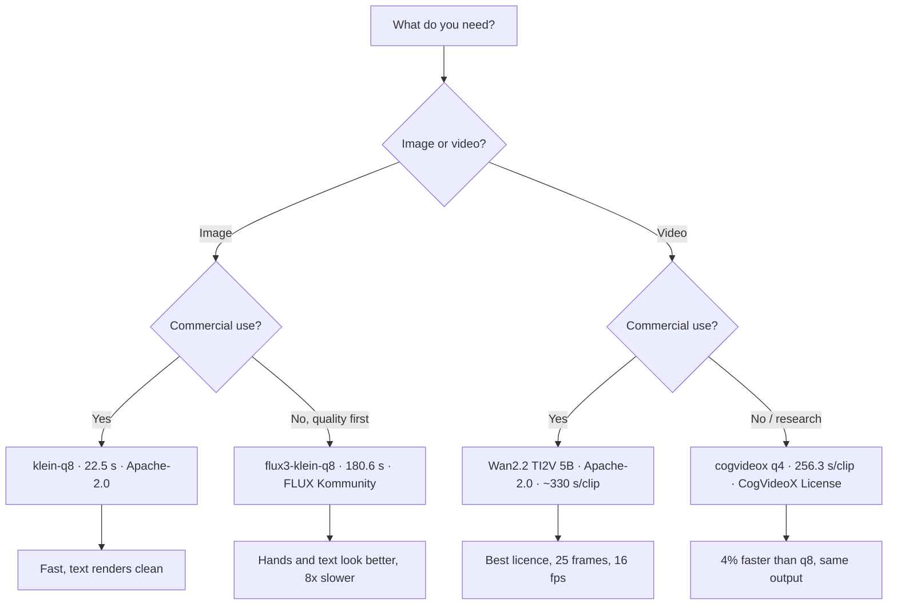
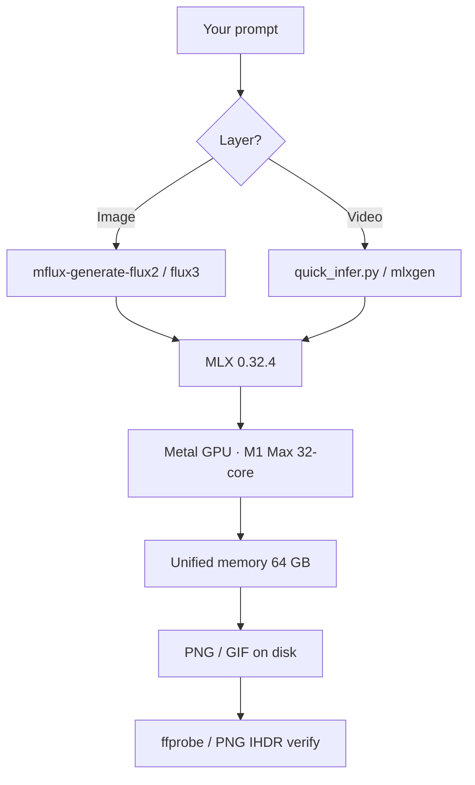
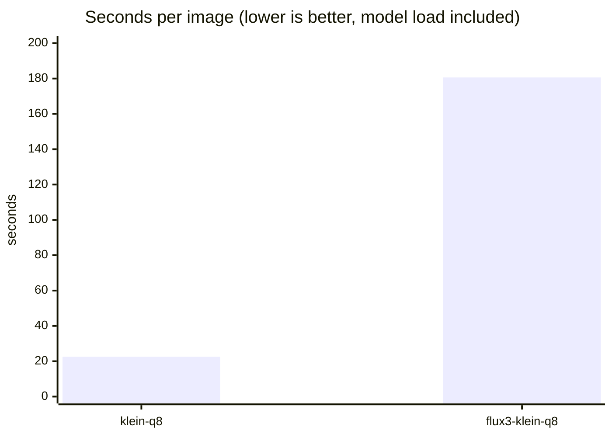
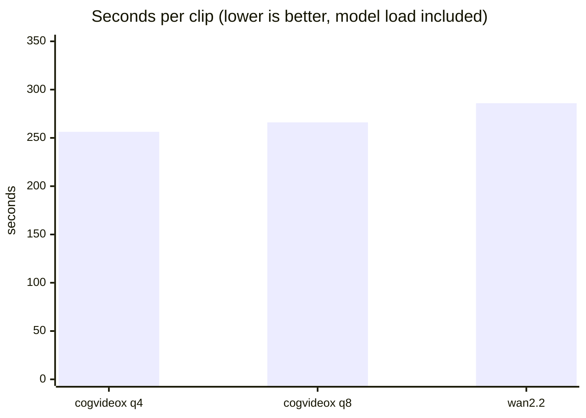

# local-generation-benchmark-m1-max

**Local image and video generation on an Apple M1 Max — measured, and the output
committed so you can look at it.**

[-000?logo=apple&logoColor=white)](#hardware--software)
[](https://github.com/filipstrand/mflux)
[](https://github.com/dgrauet/VideoX-Fun-mlx)
[](evidence/)
[](LICENSE)

[English](README.md) · [Türkçe](README.tr.md)

---

This is the generation half of a local-MLX benchmark. Text runs on
[oMLX](https://omlx.ai) and lives in the companion repository
[mahirfatih/omlx-m1-max-benchmark](https://github.com/mahirfatih/omlx-m1-max-benchmark);
here are the two layers oMLX cannot serve:

| Layer | Tool | Model | Time | Output |
| :--- | :--- | :--- | ---: | :--- |
| **Image** | [mflux](https://github.com/filipstrand/mflux) | FLUX.2 klein 4B (q8) | **22.5 s** | 1024×1024 PNG |
| Image | mflux | FLUX 3 Image Klein | 180.6 s | 1024×1024 PNG |
| **Video** | [VideoX-Fun-mlx](https://github.com/dgrauet/VideoX-Fun-mlx) | CogVideoX-Fun V1.5 5B (int8) | **266.1 s** | 672×384, 5-frame GIF |

Every number is wall clock on this one machine, **model load included**, and every
output is verified against the file it wrote — the PNG header for images, `ffprobe`
for clips — not against a tool's log line. The image figures are the mean **after
the first image**, which is the one that pays the one-time model load; the video
figure is the mean of all four clips. The images and clips are in
[`evidence/`](evidence/) so the claim can be checked by looking, not by trusting.

**Pick by what you are doing.** The chart and the flowchart below settle most
choices; the full comparison with every figure traced to its run file is in
[`docs/reference/COMPARISON.md`](docs/reference/COMPARISON.md).



## Table of Contents

- [Hardware & Software](#hardware--software)
- [The environment](#the-environment)
- [What was measured](#what-was-measured)
- [Image generation](#image-generation)
- [Video generation](#video-generation)
- [Profiles](#profiles)
- [Reproducing](#reproducing)
- [Repository structure](#repository-structure)
- [Contributing](#contributing)
- [Notes & disclaimer](#notes--disclaimer)
- [License](#license)

## Hardware & Software

| Item | Value |
|---|---|
| Machine | **Apple MacBook Pro (16-inch, 2021)**, model `MacBookPro18,2` |
| Chip | **Apple M1 Max** (10-core CPU: 8P + 2E, 32-core GPU, 16-core Neural Engine) |
| Memory | **64 GB** unified |
| OS | **macOS 26.7.2** (build 25G332), arm64 |
| Image tool | **mflux** — native-MLX diffusion CLI, one process per prompt |
| Video tool | **VideoX-Fun-mlx** (CogVideoX-Fun), **mlx-gen** (Wan2.2) |
| Measurement | PNG IHDR for images, **`ffprobe`** for clips |

The exact model matters, so it is named rather than described — the 32-core GPU
and 400 GB/s of memory bandwidth are what the timings below are against:

- Apple's own specification: [support.apple.com/en-us/111901](https://support.apple.com/en-us/111901)
- EveryMac's breakdown of this exact configuration:
  [MacBook Pro M1 Max 10-core CPU, 32-core GPU (16-inch, 2021)](https://everymac.com/systems/apple/macbook_pro/specs/macbook-pro-m1-max-10-core-cpu-32-core-gpu-16-2021-specs.html)

### The environment

Hardware is half the story; the other half is what the weights are executed by.
Nothing in this repository calls `llama.cpp`, `ollama`, or a GGUF runtime — text
LLMs are the companion repository's job. Both layers here are model-specific
Python inference engines on Apple's [MLX](https://github.com/ml-explore/mlx)
framework, which is the tensor runtime (the PyTorch-shaped layer), not the engine:

| Layer | What runs the model | What that sits on |
| :--- | :--- | :--- |
| Image | **mflux** — FLUX graph, sampler, VAE, tokenizer | MLX → Metal |
| Video (Wan) | **mlx-gen** — Wan2.2 graph and sampler | MLX → Metal |
| Video (CogVideoX) | **VideoX-Fun-mlx** — CogVideoX-Fun graph and sampler | MLX → Metal |
| Measurement | `scripts/measure/*.py` — spawns the engine, times it, verifies the file | Python 3 stdlib |

Exact versions this was measured on:

| Item | Value |
|---|---|
| Python | **3.15.2** (CPython, arm64, from Homebrew) |
| Virtualenv | `~/Sites/.mlxgen-venv` (1.4 GB, isolated — not Homebrew's site-packages) |
| `mlx` | **0.32.4** |
| `mlx-metal` | **0.32.4** |
| `mlx-gen` | **0.38.0** (ships the `mflux-generate*` commands *and* `mlxgen`) |
| `mlx-arsenal` | **0.19.0** (required by VideoX-Fun-mlx, not pulled in by mlx-gen) |
| `ffmpeg` / `ffprobe` | **9.0.2** |

`pip install mflux` does **not** appear anywhere on purpose: mflux arrives inside
the `mlx-gen` package, and installing both into one environment makes the two
disagree about who owns the `mflux-generate*` scripts. That clash is why this is
a dedicated virtualenv rather than a `uv tool install`.

```bash
python3.15 -m venv ~/Sites/.mlxgen-venv
~/Sites/.mlxgen-venv/bin/pip install mlx-gen mlx-arsenal
export PATH="$HOME/Sites/.mlxgen-venv/bin:$PATH"   # the harnesses call tools by name
```

One GPU job at a time: the harnesses refuse to start while another `mflux`,
`mlxgen`, or `quick_infer` process is alive — two of these do not fit in 64 GB of
unified memory at once.



**No API, no account, no per-call bill.** Every model runs from weights on disk.

## What was measured

| Suite | Origin | What it measures |
| :--- | :--- | :--- |
| Image | ours, over **mflux** | Seconds per image, PNG verified |
| Video | ours, over **VideoX-Fun-mlx** | Seconds per clip, `ffprobe` verified |
| Licences | ours, from the HF cards | "Downloadable" vs "commercially usable" |

Both harnesses run offline against themselves before they touch a model:
`python3 scripts/measure/<suite>.py --selftest`. `test/test.sh` runs the gate and
proves the harnesses agree with their own fixtures.

The tools we measured **through**, without which there would be no column at all:
[mflux](https://github.com/filipstrand/mflux),
[VideoX-Fun-mlx](https://github.com/dgrauet/VideoX-Fun-mlx),
[mlx-gen](https://github.com/lpalbou/mlx-gen), over
[MLX](https://github.com/ml-explore/mlx). The full reading — including what is
ours and what is borrowed — is in
[`docs/reference/COMPARISON.md`](docs/reference/COMPARISON.md).

## Image generation

Image runs through [mflux](https://github.com/filipstrand/mflux), a native-MLX
diffusion tool. One `mflux-generate-*` process per prompt, timed end to end, the
written PNG verified.

| Model (profile) | Licence | s/img | s/step | Steps | Size |
| :--- | :--- | ---: | ---: | ---: | :--- |
| `flux2-klein-4b-mflux-q8` (`klein-q8`) | Apache-2.0 | **22.5** | 5.6 | 4 | 1024×1024 |
| `flux-3-image-klein-base-mflux-q8` (`flux3-klein-q8`) | FLUX Kommunity | 180.6 | 11.3 | 16 | 1024×1024 |



A 4-step distilled 4B model runs ~22.5 s per 1024×1024 image (the first is slower,
~28 s, because the model loads); FLUX 3 at 16 steps and a 5.6B transformer takes
~180 s. Both figures are the mean of the seven steady-state images, with the
first — the one that includes model load — left out; that is the `s/img` column.
**klein-q8 wins by 8×** and is the one to use unless you need FLUX 3
specifically. Legible text and correct hands — the classic failure surfaces — come
out clean on both.

Sixteen images, each with the prompt that produced it:

[`evidence/image-benchmark-2026-11-12.md`](evidence/image-benchmark-2026-11-12.md)
and [`evidence/image-benchmark-flux3-2026-11-12.md`](evidence/image-benchmark-flux3-2026-11-12.md).

## Video generation

Video runs through [VideoX-Fun-mlx](https://github.com/dgrauet/VideoX-Fun-mlx)
driving CogVideoX-Fun V1.5 5B (int8). One runner process per prompt, timed end to
end, and every clip verified with `ffprobe` — the file, not the runner's log line.

| Model (profile) | Licence | s/clip | Output | Frames | OK |
| :--- | :--- | ---: | :--- | ---: | :---: |
| `dgrauet/CogVideoX-Fun-V1.5-5b-InP-mlx-q8` (`cogvideox-fun-1.5-5b-inp-q8`) | **The CogVideoX License** | **266.1** | 672×384, 1.6 s, GIF | 5 | ✅ 4/4 |
| `dgrauet/CogVideoX-Fun-V1.5-5b-InP-mlx-q4` (`cogvideox-fun-1.5-5b-inp-q4`) | **The CogVideoX License** | **256.3** | 672×384, 1.6 s, GIF | 5 | ✅ 4/4 |
| `AbstractFramework/wan2.2-ti2v-5b-diffusers-8bit` (`wan22-ti2v-5b-q8`) | Apache-2.0 | **285.9** | 480×832, 1.6 s, MP4 | 25 | ✅ 4/4 |



**266.1 s** for a 5-frame 672×384 clip — the mean of four prompts spanning
265.2–267.2 s — so a clip that plays for 1.6 s costs about 4.4 minutes of GPU. Five frames is the model's ceiling,
not a setting: `--frames` is not linear (4 → 1 frame, 8 → the same 5 as 5, an odd
count raises a reshape error), so asking for more does not get you more.

A q4 quantisation of the same model runs at 256.3 s/clip (about 4% faster) at
identical output; both rows are in
[`evidence/video-benchmark-2026-11-12.md`](evidence/video-benchmark-2026-11-12.md).

The four clips, each with the prompt that produced it, are in
[`evidence/video-benchmark-2026-11-12.md`](evidence/video-benchmark-2026-11-12.md).

## Profiles

Each layer has its own profile file — **no image or video setting is an oMLX
profile**, because oMLX cannot run either:

| Setting | `klein-q8` | `flux3-klein-q8` | `cogvideox-fun-1.5-5b-inp-q8` |
| :--- | ---: | ---: | ---: |
| Layer | image | image | video |
| Size | 1024×1024 | 1024×1024 | 672×384 |
| Steps | 4 | 16 | 50 |
| Guidance | 1.0 | — (distilled) | 6.0 |
| Seed | 42 | 42 | 42 |
| Output | PNG | PNG | GIF, 5 frames |

Full settings, why each value was chosen, and the exact commands to reproduce a
run are in [`docs/reference/PROFILES.md`](docs/reference/PROFILES.md).

## Reproducing

1. Build the environment once — Python 3.15, one virtualenv, two installs:

   ```bash
   brew install python@3.15 ffmpeg
   python3.15 -m venv ~/Sites/.mlxgen-venv
   ~/Sites/.mlxgen-venv/bin/pip install mlx-gen mlx-arsenal
   export PATH="$HOME/Sites/.mlxgen-venv/bin:$PATH"
   git clone https://github.com/dgrauet/VideoX-Fun-mlx ~/Sites/VideoX-Fun-mlx
   ```

   Why each piece, and what is deliberately *not* installed, is in
   [`docs/reference/ENVIRONMENT.md`](docs/reference/ENVIRONMENT.md).
2. Download the model weights (see [`docs/reference/PROFILES.md`](docs/reference/PROFILES.md)
   for the exact model ids).
3. Run the harness or the one-shot CLI — both are in
   [`docs/reference/PROFILES.md`](docs/reference/PROFILES.md#running-these-yourself).

```bash
# Image: the whole eight-prompt suite
python3 scripts/measure/image-benchmark.py --profile klein-q8 --out-dir ./out

# Video: the whole four-prompt suite
python3 scripts/measure/video-benchmark.py \
  --profile cogvideox-fun-1.5-5b-inp-q8 \
  --repo ~/Sites/VideoX-Fun-mlx \
  --model ~/Sites/VideoX-Fun-mlx/models/cogvideox-fun-q8 \
  --out-dir /tmp/videorun --json-out /tmp/videorun/results.json
```

The offline gate needs no model and no network:

```bash
./test/test.sh
```

## Repository structure

```text
local-generation-benchmark-m1-max/
├── README.md · README.tr.md
├── CHANGELOG.md · CONTRIBUTING.md · CODE_OF_CONDUCT.md · SECURITY.md
├── data/                       # the prompt sets, one JSON per layer
│   ├── image-prompts.json
│   └── video-prompts.json
├── profiles/
│   ├── mflux-profiles.json     # image settings
│   └── video-profiles.json     # video settings
├── evidence/                   # the runs: pages, and the images/clips themselves
│   ├── image-benchmark-*.md
│   ├── video-benchmark-*.md
│   ├── images/                 # 16 PNGs
│   └── videos/                 # 4 GIFs
├── reference/                  # machine-readable copies of every number
├── docs/
│   ├── README.md
│   └── reference/              # comparison · profiles · licences
├── scripts/
│   ├── measure/                # image-benchmark.py, video-benchmark.py
│   ├── release/                # export-video-evidence.py
│   └── lint.sh                 # every linter, at pinned versions
├── test/test.sh                # offline gate
└── .github/workflows/ci.yml    # the gate and the lint run, on demand
```

## Contributing

Corrections and additional data points are welcome — see
[`CONTRIBUTING.md`](CONTRIBUTING.md). A timing must arrive with the output it
timed. Run `./test/test.sh` before you push; [`scripts/lint.sh`](scripts/lint.sh)
runs every linter at once.

## Notes & disclaimer

- **Timings are for this machine only.** A different M1/M2/M3/M4 changes them.
- **Sample sizes are small.** Eight image prompts, four video prompts. A gap of a
  second or two is noise; an 8× gap is not.
- **Speed and quality are not one score.** Look at
  [`evidence/images/`](evidence/images/) and [`evidence/videos/`](evidence/videos/)
  and judge the output.
- **Download is not a licence.** FLUX 3 and CogVideoX carry terms that Apache-2.0
  does not; see [`docs/reference/LICENSES.md`](docs/reference/LICENSES.md) before
  shipping anything into something that earns money.
- This repository redistributes **no model weights** — only measurements and the
  outputs those models produced.

## License

The code and documents here are **MIT** (see [`LICENSE`](LICENSE)). That covers
this repository, not the models it measures: the model licences are the property
of their authors and travel with the weights.
