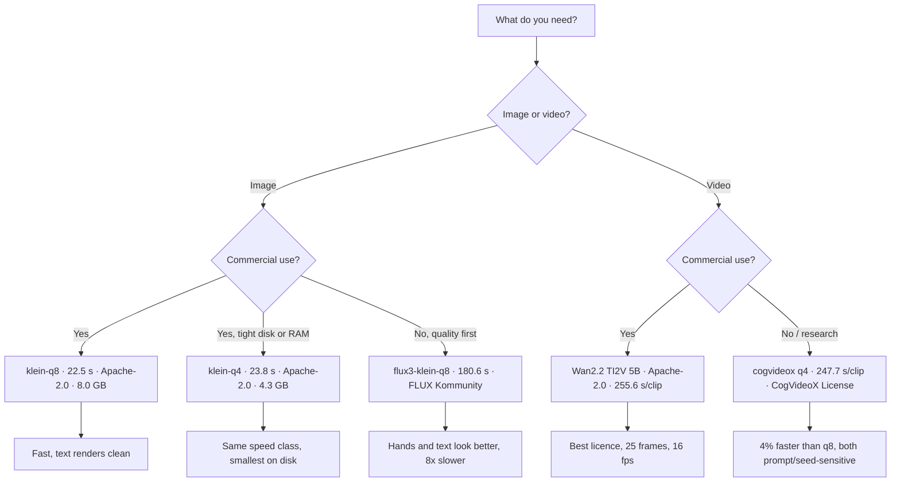
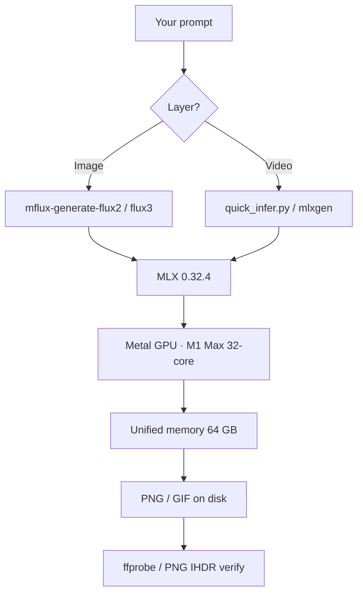
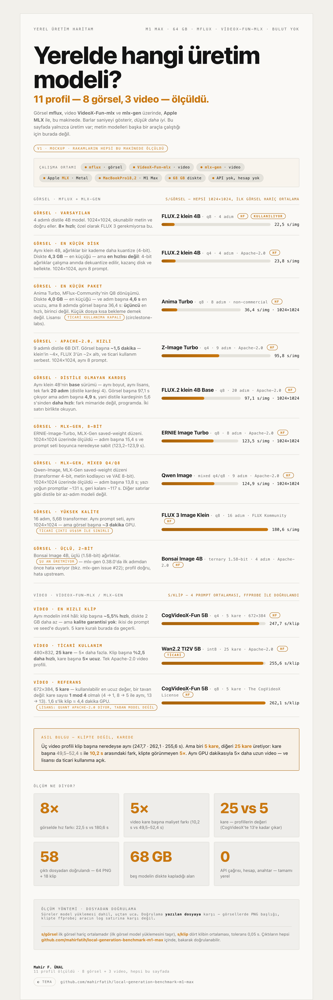
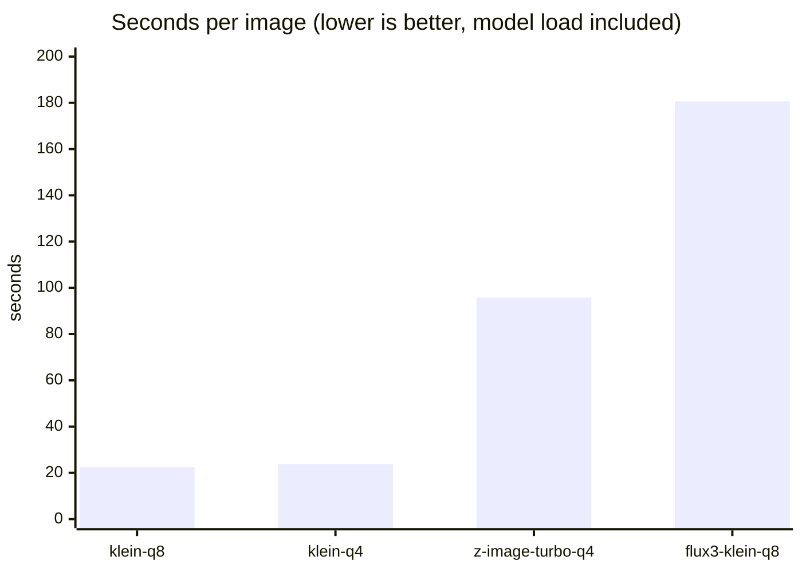
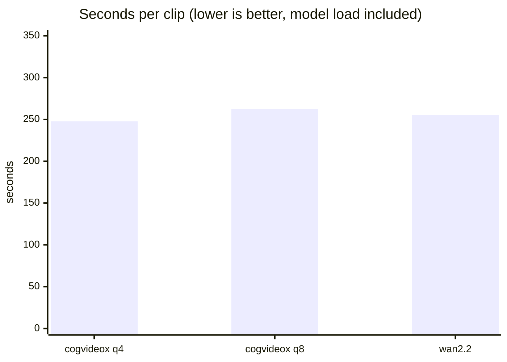

# Local Image and Video Generation on an Apple M1 Max 64GB

**Local image and video generation on an Apple M1 Max — measured, and the output
committed so you can look at it.**

[-000?logo=apple&logoColor=white)](#hardware--software)
[](https://github.com/filipstrand/mflux)
[](https://github.com/dgrauet/VideoX-Fun-mlx)
[](evidence/)
[](LICENSE)

[English](README.md) · [Türkçe](README.tr.md)

---

This is the generation half of a local-MLX benchmark. Text runs on
[oMLX](https://omlx.ai) and lives in the companion repository
[mahirfatih/omlx-m1-max-benchmark](https://github.com/mahirfatih/omlx-m1-max-benchmark);
here are the two layers oMLX cannot serve:

| Layer | Tool | Model | Time | Output |
| :--- | :--- | :--- | ---: | :--- |
| **Image** | [mflux](https://github.com/filipstrand/mflux) | FLUX.2 klein 4B (q8) | **22.5 s** | 1024×1024 PNG |
| Image | mflux | FLUX.2 klein 4B (q4) | 23.8 s | 1024×1024 PNG |
| Image | mflux | Z-Image Turbo (q4) | 95.8 s | 1024×1024 PNG |
| Image | mflux | FLUX 3 Image Klein | 180.6 s | 1024×1024 PNG |
| Image | [mlx-gen](https://github.com/lpalbou/mlx-gen) | Qwen Image (mixed q4/q8) | 30.5 s | 512×512 PNG |
| **Video** | [VideoX-Fun-mlx](https://github.com/dgrauet/VideoX-Fun-mlx) | CogVideoX-Fun V1.5 5B (int8) | **262.1 s** | 672×384, 5-frame GIF |
| Video | VideoX-Fun-mlx | CogVideoX-Fun V1.5 5B (int4) | 247.7 s | 672×384, 5-frame GIF |
| Video | [mlx-gen](https://github.com/lpalbou/mlx-gen) | Wan2.2 TI2V 5B (int8) | 255.6 s | 480×832, 25-frame MP4 |

Every number is wall clock on this one machine, **model load included**, and every
output is verified against the file it wrote — the PNG header for images, `ffprobe`
for clips — not against a tool's log line. The image figures are the mean **after
the first image**, which is the one that pays the one-time model load; each video
figure is that model's own mean over its six clips. Qwen Image is the one image row
at **512×512** rather than 1024×1024, so read it per step, not per image. The images
and clips are in
[`evidence/`](evidence/) so the claim can be checked by looking, not by trusting.

**Pick by what you are doing.** The chart and the flowchart below settle most
choices; the full comparison with every figure traced to its run file is in
[`docs/reference/COMPARISON.md`](docs/reference/COMPARISON.md).



## Table of Contents

- [Hardware & Software](#hardware--software)
- [The environment](#the-environment)
- [What was measured](#what-was-measured)
- [Image generation](#image-generation)
- [Video generation](#video-generation)
- [Profiles](#profiles)
- [Reproducing](#reproducing)
- [Repository structure](#repository-structure)
- [Contributing](#contributing)
- [Notes & disclaimer](#notes--disclaimer)
- [License](#license)

## Hardware & Software

| Item | Value |
|---|---|
| Machine | **Apple MacBook Pro (16-inch, 2021)**, model `MacBookPro18,2` |
| Chip | **Apple M1 Max** (10-core CPU: 8P + 2E, 32-core GPU, 16-core Neural Engine) |
| Memory | **64 GB** unified |
| OS | **macOS 26.7.2** (build 25G332), arm64 |
| Image tool | **mflux** — native-MLX diffusion CLI, one process per prompt |
| Video tool | **VideoX-Fun-mlx** (CogVideoX-Fun), **mlx-gen** (Wan2.2) |
| Measurement | PNG IHDR for images, **`ffprobe`** for clips |

The exact model matters, so it is named rather than described — the 32-core GPU
and 400 GB/s of memory bandwidth are what the timings below are against:

- Apple's own specification: [support.apple.com/en-us/111901](https://support.apple.com/en-us/111901)
- EveryMac's breakdown of this exact configuration:
  [MacBook Pro M1 Max 10-core CPU, 32-core GPU (16-inch, 2021)](https://everymac.com/systems/apple/macbook_pro/specs/macbook-pro-m1-max-10-core-cpu-32-core-gpu-16-2021-specs.html)

### The environment

Hardware is half the story; the other half is what the weights are executed by.
Nothing in this repository calls `llama.cpp`, `ollama`, or a GGUF runtime — text
LLMs are the companion repository's job. Both layers here are model-specific
Python inference engines on Apple's [MLX](https://github.com/ml-explore/mlx)
framework, which is the tensor runtime (the PyTorch-shaped layer), not the engine:

| Layer | What runs the model | What that sits on |
| :--- | :--- | :--- |
| Image | **mflux** — FLUX graph, sampler, VAE, tokenizer | MLX → Metal |
| Video (Wan) | **mlx-gen** — Wan2.2 graph and sampler | MLX → Metal |
| Video (CogVideoX) | **VideoX-Fun-mlx** — CogVideoX-Fun graph and sampler | MLX → Metal |
| Measurement | `scripts/measure/*.py` — spawns the engine, times it, verifies the file | Python 3 stdlib |

Exact versions this was measured on:

| Item | Value |
|---|---|
| Python | **3.15.2** (CPython, arm64, from Homebrew) |
| Virtualenv | `~/Sites/.mlxgen-venv` (1.4 GB, isolated — not Homebrew's site-packages) |
| `mlx` | **0.32.4** |
| `mlx-metal` | **0.32.4** |
| `mlx-gen` | **0.38.0** (ships the `mflux-generate*` commands *and* `mlxgen`) |
| `mlx-arsenal` | **0.19.0** (required by VideoX-Fun-mlx, not pulled in by mlx-gen) |
| `ffmpeg` / `ffprobe` | **9.0.2** |

`pip install mflux` does **not** appear anywhere on purpose: mflux arrives inside
the `mlx-gen` package, and installing both into one environment makes the two
disagree about who owns the `mflux-generate*` scripts. That clash is why this is
a dedicated virtualenv rather than a `uv tool install`.

```bash
python3.15 -m venv ~/Sites/.mlxgen-venv
~/Sites/.mlxgen-venv/bin/pip install mlx-gen mlx-arsenal
export PATH="$HOME/Sites/.mlxgen-venv/bin:$PATH"   # the harnesses call tools by name
```

One GPU job at a time: the harnesses refuse to start while another `mflux`,
`mlxgen`, or `quick_infer` process is alive — two of these do not fit in 64 GB of
unified memory at once.



**No API, no account, no per-call bill.** Every model runs from weights on disk.

## Models

| Model | Disk | Quant | Licence | Source |
|---|---:|---|---|---|
| `flux2-klein-4b-mflux-q8` | 8.0 GB | int8 | Apache-2.0 | [HF](https://huggingface.co/mflux-community/flux2-klein-4b-mflux-q8) |
| `FLUX.2-klein-4B-mflux-4bit` | 4.3 GB | int4 | Apache-2.0 | [HF](https://huggingface.co/Runpod/FLUX.2-klein-4B-mflux-4bit) |
| `flux-3-image-klein-base-mflux-q8` | 9.2 GB | int8 | FLUX Kommunity | [HF](https://huggingface.co/mflux-community/flux-3-image-klein-base-mflux-q8) |
| `z-image-turbo-mflux-q4` | 5.5 GB | int4 | Apache-2.0 | [HF](https://huggingface.co/mflux-community/z-image-turbo-mflux-q4) |
| `bonsai-image-ternary-4B-mlx-2bit` | 3.6 GB | ternary 1.58-bit | Apache-2.0 | [HF](https://huggingface.co/prism-ml/bonsai-image-ternary-4B-mlx-2bit) |
| `ernie-image-turbo-8bit` | 11.5 GB | int8 | Apache-2.0 | [HF](https://huggingface.co/AbstractFramework/ernie-image-turbo-8bit) |
| `qwen-image-4bit` | 16.2 GB | mixed q4/q8 | Apache-2.0 | [HF](https://huggingface.co/AbstractFramework/qwen-image-4bit) |
| `CogVideoX-Fun-V1.5-5b-InP-mlx-q8` | 15 GB | int8 | CogVideoX License | [HF](https://huggingface.co/dgrauet/CogVideoX-Fun-V1.5-5b-InP-mlx-q8) |
| `CogVideoX-Fun-V1.5-5b-InP-mlx-q4` | 13 GB | int4 | CogVideoX License | [HF](https://huggingface.co/dgrauet/CogVideoX-Fun-V1.5-5b-InP-mlx-q4) |
| `wan2.2-ti2v-5b-diffusers-8bit` | 17 GB | int8 | Apache-2.0 | [HF](https://huggingface.co/AbstractFramework/wan2.2-ti2v-5b-diffusers-8bit) |

**Total on disk:** ~88 GB · **Runtime memory:** up to ~30 GB per loaded model on 64 GB unified memory. Every model runs from weights on disk — no API, no account.

## Model map



[`docs/diagrams/model-map/model-map.html`](docs/diagrams/model-map/model-map.html) — the interactive version (theme toggle). [`model-map-dark.png`](docs/diagrams/model-map/model-map-dark.png) for the dark theme.

Which generation model for which job, at the seconds it actually cost, in one picture.

## What was measured

| Suite | Origin | What it measures |
| :--- | :--- | :--- |
| Image | ours, over **mflux** | Seconds per image, PNG verified |
| Video | ours, over **VideoX-Fun-mlx** | Seconds per clip, `ffprobe` verified |
| Licences | ours, from the HF cards | "Downloadable" vs "commercially usable" |

Both harnesses run offline against themselves before they touch a model:
`python3 scripts/measure/<suite>.py --selftest`. `test/test.sh` runs the gate and
proves the harnesses agree with their own fixtures. The gate is twelve steps —
syntax and naming, prompt sets, profiles, evidence links, licences, both
selftests, the reference figures recomputed from the JSON, the Mermaid diagrams,
the model map's files, PNGs and Hugging Face links, and that every profile is
named in every document that lists models.

The tools we measured **through**, without which there would be no column at all:
[mflux](https://github.com/filipstrand/mflux),
[VideoX-Fun-mlx](https://github.com/dgrauet/VideoX-Fun-mlx),
[mlx-gen](https://github.com/lpalbou/mlx-gen), over
[MLX](https://github.com/ml-explore/mlx). The full reading — including what is
ours and what is borrowed — is in
[`docs/reference/COMPARISON.md`](docs/reference/COMPARISON.md).

## Image generation

Image runs through [mflux](https://github.com/filipstrand/mflux), a native-MLX
diffusion tool. One `mflux-generate-*` process per prompt, timed end to end, the
written PNG verified.

| Model (profile) | Licence | s/img | s/step | Steps | Size |
| :--- | :--- | ---: | ---: | ---: | :--- |
| [`flux2-klein-4b-mflux-q8`](https://huggingface.co/mflux-community/flux2-klein-4b-mflux-q8) (`klein-q8`) | Apache-2.0 | **22.5** | 5.6 | 4 | 1024×1024 |
| [`FLUX.2-klein-4B-mflux-4bit`](https://huggingface.co/Runpod/FLUX.2-klein-4B-mflux-4bit) (`klein-q4`) | Apache-2.0 | 23.8 | 5.9 | 4 | 1024×1024 |
| [`z-image-turbo-mflux-q4`](https://huggingface.co/mflux-community/z-image-turbo-mflux-q4) (`z-image-turbo-q4`) | Apache-2.0 | 95.8 | 10.6 | 9 | 1024×1024 |
| [`flux-3-image-klein-base-mflux-q8`](https://huggingface.co/mflux-community/flux-3-image-klein-base-mflux-q8) (`flux3-klein-q8`) | FLUX Kommunity | 180.6 | 11.3 | 16 | 1024×1024 |

`qwen-image-4bit` is measured too, but at **512×512** rather than 1024×1024, so it is
not in the table above: `AbstractFramework/qwen-image-4bit` runs through **mlx-gen**,
not mflux, and its **30.5 s/img** (3.4 s/step, 9 steps) buys a quarter of the pixels
the mflux rows do. Compare it with `z-image-turbo-q4` per step, not per image.



A 4-step distilled 4B model runs ~22.5 s per 1024×1024 image (the first is slower,
~28 s, because the model loads); FLUX 3 at 16 steps and a 5.6B transformer takes
~180 s. Z-Image Turbo — a 9-step distilled 6B model, Apache-2.0 — sits between them
at **95.8 s**, ~4.3× slower than klein and ~1.9× faster than FLUX 3. The **4-bit
klein** (`klein-q4`) is the smallest on disk at 4.3 GB but *not* the fastest: at
**23.8 s** it is +1.3 s (+5.8 %) behind the 8-bit sibling, because the checkpoint
ships its own 4-bit weights that are dequantised on the fly — the saving is disk and
memory, not seconds. All figures are
the mean of the seven steady-state images, with the first — the one that includes
model load — left out; that is the `s/img` column. **klein-q8 wins by 8×** and is the
one to use unless you need FLUX 3 specifically. Legible text and correct hands — the
classic failure surfaces — come out clean on all. Z-Image Turbo is the Apache-2.0
alternative when FLUX 3's commercial-output cap rules it out but klein's speed is
not the priority.

Thirty-two images, each with the prompt that produced it:

[`evidence/image-benchmark-2026-11-12.md`](evidence/image-benchmark-2026-11-12.md),
[`evidence/image-benchmark-flux3-2026-11-12.md`](evidence/image-benchmark-flux3-2026-11-12.md),
[`evidence/image-benchmark-zimage-2026-11-14.md`](evidence/image-benchmark-zimage-2026-11-14.md)
and [`evidence/image-benchmark-klein-q4-2026-11-17.md`](evidence/image-benchmark-klein-q4-2026-11-17.md).

## Video generation

Video runs through [VideoX-Fun-mlx](https://github.com/dgrauet/VideoX-Fun-mlx)
driving CogVideoX-Fun V1.5 5B (int8). One runner process per prompt, timed end to
end, and every clip verified with `ffprobe` — the file, not the runner's log line.

| Model (profile) | Licence | s/clip | Output | Frames | OK |
| :--- | :--- | ---: | :--- | ---: | :---: |
| [`dgrauet/CogVideoX-Fun-V1.5-5b-InP-mlx-q4`](https://huggingface.co/dgrauet/CogVideoX-Fun-V1.5-5b-InP-mlx-q4) (`cogvideox-fun-1.5-5b-inp-q4`) | **The CogVideoX License** | **247.7** | 672×384, 1.6 s, GIF | 5 | ✅ 6/6 |
| [`dgrauet/CogVideoX-Fun-V1.5-5b-InP-mlx-q8`](https://huggingface.co/dgrauet/CogVideoX-Fun-V1.5-5b-InP-mlx-q8) (`cogvideox-fun-1.5-5b-inp-q8`) | **The CogVideoX License** | **262.1** | 672×384, 1.6 s, GIF | 5 | ✅ 6/6 |
| [`AbstractFramework/wan2.2-ti2v-5b-diffusers-8bit`](https://huggingface.co/AbstractFramework/wan2.2-ti2v-5b-diffusers-8bit) (`wan22-ti2v-5b-q8`) | Apache-2.0 | **255.6** | 480×832, 1.6 s, MP4 | 25 | ✅ 6/6 |



**262.1 s** for a 5-frame 672×384 clip — the mean of six prompts spanning
258.7–274.9 s — so a clip that plays for 1.6 s costs over four minutes of GPU.
Five frames is the cheapest usable value, not a ceiling: `--frames` must be
`1 mod 4` and the pipeline decodes `(F-1)//4*4+1` frames, so 4 gives 1, 8 gives
the same 5 as 5, and 13 gives 13 — while 9, 17 and 25 raise a reshape error.

A q4 quantisation of the same model runs at 247.7 s/clip (about 5.5% faster) with
the same output shape but **no quality guarantee on either quant**: both are
prompt- and seed-sensitive, so a fast row is a compute measurement — the file is
the proof. Wan2.2's `s/clip` is the most prompt-dependent of the three
(233.7–299.8 s across the same six prompts) against CogVideoX's under-17 s spread.
All three rows are in
[`evidence/video-benchmark-2026-11-12.md`](evidence/video-benchmark-2026-11-12.md).

The eighteen clips, each with the prompt that produced it, are in
[`evidence/video-benchmark-2026-11-12.md`](evidence/video-benchmark-2026-11-12.md).

## Profiles

Each layer has its own profile file — **no image or video setting is an oMLX
profile**, because oMLX cannot run either:

| Setting | `klein-q8` | `flux3-klein-q8` | `cogvideox-fun-1.5-5b-inp-q8` |
| :--- | ---: | ---: | ---: |
| Layer | image | image | video |
| Size | 1024×1024 | 1024×1024 | 672×384 |
| Steps | 4 | 16 | 50 |
| Guidance | 1.0 | — (distilled) | 6.0 |
| Seed | 42 | 42 | 42 |
| Output | PNG | PNG | GIF, 5 frames |

Full settings, why each value was chosen, and the exact commands to reproduce a
run are in [`docs/reference/PROFILES.md`](docs/reference/PROFILES.md).

## Reproducing

1. Build the environment once — Python 3.15, one virtualenv, two installs:

   ```bash
   brew install python@3.15 ffmpeg
   python3.15 -m venv ~/Sites/.mlxgen-venv
   ~/Sites/.mlxgen-venv/bin/pip install mlx-gen mlx-arsenal
   export PATH="$HOME/Sites/.mlxgen-venv/bin:$PATH"
   git clone https://github.com/dgrauet/VideoX-Fun-mlx ~/Sites/VideoX-Fun-mlx
   ```

   Why each piece, and what is deliberately *not* installed, is in
   [`docs/reference/ENVIRONMENT.md`](docs/reference/ENVIRONMENT.md).
2. Download the model weights (see [`docs/reference/PROFILES.md`](docs/reference/PROFILES.md)
   for the exact model ids).
3. Run the harness or the one-shot CLI — both are in
   [`docs/reference/PROFILES.md`](docs/reference/PROFILES.md#running-these-yourself).

```bash
# Image: the whole eight-prompt suite
python3 scripts/measure/image-benchmark.py --profile klein-q8 --out-dir ./out

# Video: the whole six-prompt suite
python3 scripts/measure/video-benchmark.py \
  --profile cogvideox-fun-1.5-5b-inp-q8 \
  --repo ~/Sites/VideoX-Fun-mlx \
  --model ~/Sites/VideoX-Fun-mlx/models/cogvideox-fun-q8 \
  --out-dir /tmp/videorun --json-out /tmp/videorun/results.json
```

The offline gate needs no model and no network:

```bash
./test/test.sh
```

## Repository structure

```text
Local Image and Video Generation on an Apple M1 Max 64GB/
├── README.md · README.tr.md
├── CHANGELOG.md · CONTRIBUTING.md · CODE_OF_CONDUCT.md · SECURITY.md
├── data/                       # the prompt sets, one JSON per layer
│   ├── image-prompts.json
│   └── video-prompts.json
├── profiles/
│   ├── mflux-profiles.json     # image settings
│   └── video-profiles.json     # video settings
├── evidence/                   # the runs: pages, and the images/clips themselves
│   ├── image-benchmark-*.md
│   ├── video-benchmark-*.md
│   ├── images/                 # 24 PNGs
│   └── videos/                 # 4 GIFs
├── reference/                  # machine-readable copies of every number
├── docs/
│   ├── README.md
│   ├── diagrams/               # the model-map poster: HTML original + rendered PNGs
│   ├── guides/                 # naming conventions
│   └── reference/              # comparison · profiles · licences · environment
├── scripts/
│   ├── measure/                # image-benchmark.py, video-benchmark.py
│   ├── release/                # export-video-evidence.py
│   ├── render/                 # render-model-map.py — poster HTML → PNG
│   └── lint.sh                 # every linter, at pinned versions
├── test/test.sh                # offline gate
└── .github/workflows/ci.yml    # the gate and the lint run, on demand
```

## Contributing

Corrections and additional data points are welcome — see
[`CONTRIBUTING.md`](CONTRIBUTING.md). A timing must arrive with the output it
timed. Run `./test/test.sh` before you push; [`scripts/lint.sh`](scripts/lint.sh)
runs every linter at once.

## Notes & disclaimer

- **Timings are for this machine only.** A different M1/M2/M3/M4 changes them.
- **Sample sizes are small.** Eight image prompts, six video prompts. A gap of a
  second or two is noise; an 8× gap is not.
- **Speed and quality are not one score.** Look at
  [`evidence/images/`](evidence/images/) and [`evidence/videos/`](evidence/videos/)
  and judge the output.
- **Download is not a licence.** FLUX 3 and CogVideoX carry terms that Apache-2.0
  does not; see [`docs/reference/LICENSES.md`](docs/reference/LICENSES.md) before
  shipping anything into something that earns money.
- This repository redistributes **no model weights** — only measurements and the
  outputs those models produced.

## License

The code and documents here are **MIT** (see [`LICENSE`](LICENSE)). That covers
this repository, not the models it measures: the model licences are the property
of their authors and travel with the weights.
