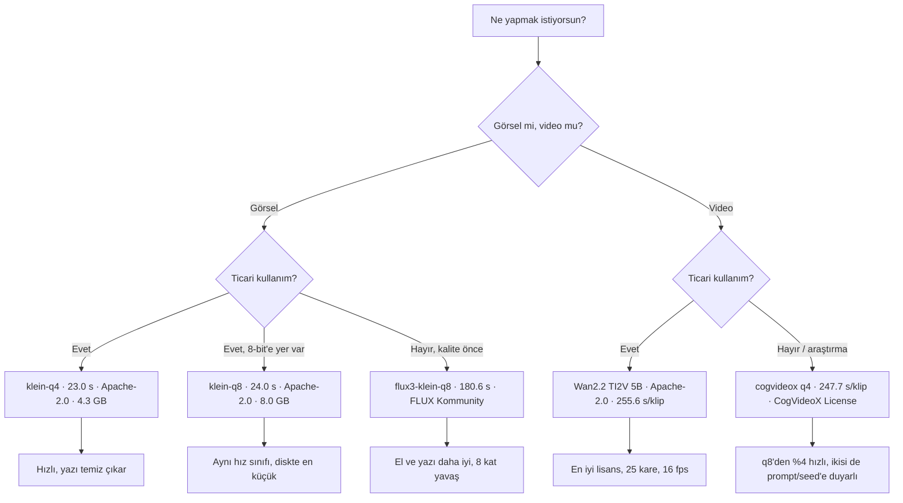
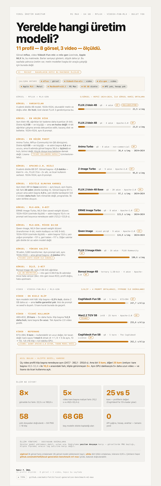

# Local Image and Video Generation on an Apple M1 Max 64GB

[-000?logo=apple&logoColor=white)](#donanım--yazılım)
[](https://github.com/filipstrand/mflux)
[](https://github.com/dgrauet/VideoX-Fun-mlx)
[](evidence/)
[](LICENSE)

| 🎯 Amaç | 🧩 Motorlar | 📊 Kanıt | ⚖️ Lisans |
| :---: | :---: | :---: | :---: |
| M1 Max'te ölçülmüş yerel görsel/video üretimi | mflux · mlx-gen · VideoX-Fun-mlx | 80 PNG + 18 klip | MIT |

> **Yeni misin?** [Genel bakış](#genel-bakış) · [Ne ölçüldü](#ne-ölçüldü) · [Görseller](#görsel-üretimi) · [Videolar](#video-üretimi) · [Profiller](#profiller)

**Türkçe** · [English](README.md)

---

<a id="contents"></a>

## 🧭 İçindekiler

| # | Bölüm | Neyi cevaplar |
| :---: | :--- | :--- |
| 01 | [📖 Genel bakış](#genel-bakış) | Bu depo neyi ölçer, neden |
| 02 | [💻 Donanım & Yazılım](#donanım--yazılım) | Makine, araç zinciri ve sürümler |
| 03 | [🧩 Modeller](#modeller) | Diskteki ağırlıklar, quant ve lisans |
| 04 | [🗺️ Model haritası](#model-haritası) | Hangi iş için hangi model |
| 05 | [📊 Ne ölçüldü](#ne-ölçüldü) | Harness'lar, kapılar ve kaynak |
| 06 | [🖼️ Görsel üretimi](#görsel-üretimi) | 1024×1024 görsel satırları |
| 07 | [🎬 Video üretimi](#video-üretimi) | Klip satırları |
| 08 | [⚙️ Profiller](#profiller) | Her satırın ayarları |
| 09 | [🔁 Çoğaltma](#çoğaltma) | Ölçümü yeniden çalıştırma |
| 10 | [📂 Depo yapısı](#depo-yapısı) | Dosyalar nerede |
| 11 | [🔗 Bağlantılar](#bağlantılar) | Yardımcı depo, araçlar, kaynaklar |
| 12 | [⚠️ Notlar ve sorumluluk reddi](#notlar-ve-sorumluluk-reddi) | Sayıların neyi söyleyip neyi söylemediği |
| 13 | [📄 Lisans](#lisans) | Dağıtım koşulları |

<details>
<summary>🔎 <b>Ölçümlere atla</b></summary>

- [🧪 Ortam](#ortam)
- [🖼️ Görsel tablosu](#görsel-üretimi)
- [🎬 Video tablosu](#video-üretimi)
- [🧩 Model envanteri](#modeller)
- [🗺️ Model haritası](#model-haritası)

</details>

---

<a id="genel-bakış"></a>

## 📖 Genel bakış

Yerel-MLX benchmark'ının **üretim yarısı**. Metin [oMLX](https://omlx.ai) üzerinde
çalışır ve
[companion deposunda](https://github.com/mahirfatih/omlx-m1-max-benchmark)
durur; burada oMLX'in çalıştıramadığı iki katman var:

| Katman | Araç | Model | Süre | Çıktı |
| :--- | :--- | :--- | ---: | :--- |
| **Görsel** | [mflux](https://github.com/filipstrand/mflux) | FLUX.2 klein 4B (q4) | **23.0 s** | 1024×1024 PNG |
| Görsel | mflux | FLUX.2 klein 4B (q8) | 24.0 s | 1024×1024 PNG |
| Görsel | mflux | Iris-3B Turbo (q8) | 24.1 s | 1024×1024 PNG |
| Görsel | mflux | Anima Turbo (q8) | 36.4 s | 1024×1024 PNG |
| Görsel | mflux | Z-Image Turbo (q4) | 95.8 s | 1024×1024 PNG |
| Görsel | mflux | FLUX.2 klein 4B Base (q8) | 97.1 s | 1024×1024 PNG |
| Görsel | [mlx-gen](https://github.com/lpalbou/mlx-gen) | ERNIE Image Turbo (q8) | 123.5 s | 1024×1024 PNG |
| Görsel | [mlx-gen](https://github.com/lpalbou/mlx-gen) | Qwen Image (mixed q4/q8) | 124.9 s | 1024×1024 PNG |
| Görsel | mflux | Boogu Image Turbo (q8) | 160.8 s | 1024×1024 PNG |
| Görsel | mflux | FLUX 3 Image Klein | 180.6 s | 1024×1024 PNG |
| **Video** | [VideoX-Fun-mlx](https://github.com/dgrauet/VideoX-Fun-mlx) | CogVideoX-Fun V1.5 5B (int4) | **247.7 s** | 672×384, 5 kare GIF |
| Video | [mlx-gen](https://github.com/lpalbou/mlx-gen) | Wan2.2 TI2V 5B (int8) | 255.6 s | 480×832, 25 kare MP4 |
| Video | VideoX-Fun-mlx | CogVideoX-Fun V1.5 5B (int8) | 262.1 s | 672×384, 5 kare GIF |

Her sayı bu tek makinede **duvar saatiyle**, **model yüklemesi dahil** ölçüldü ve
her çıktı yazdığı dosyaya karşı doğrulandı — görsellerde PNG başlığı, kliplerde
`ffprobe` — aracın log satırına karşı değil. Satırlar süreye göre sıralı: önce
görseller, sonra klipler, her blok kendi içinde en hızlısı başta — iki birim
karşılaştırılabilir değil, bu yüzden video bloğu kendi ölçeğinde yeniden başlıyor.
Görsel figürleri ilk görselden **sonraki** ortalamadır — ilk görsel tek seferlik
model yüklemesini ödeyen görseldir; her video figürü o modelin altı klibinin kendi
ortalamasıdır. **Bütün görsel satırları artık 1024×1024**, yani görsel kolonu
benzeri benzeriyle karşılaştırır. İki görsel satırı mflux'tan geçmez —
`ernie-image-turbo-q8` ve `qwen-image-4bit` mlx-gen'den geçer; Qwen'in görsel
başına figürü gerçek bir yayılım taşır (yazı yoğun promptlar ~131 s, geri kalanı
~117 s), ERNIE ise her promptta 123.5 s'nin bir saniyesi içinde kalır. Görseller ve
klipler
[`evidence/`](evidence/) altında, yani iddia güvenmekle değil **bakarak**
kontrol edilebilir.

**Ne yapacağına göre seç.** Aşağıdaki akış çoğu kararı kendisi verir; her rakamı
geldiği koşu dosyasına izlenen tam karşılaştırma
[`docs/reference/COMPARISON.md`](docs/reference/COMPARISON.md) içindedir.



---

<a id="donanım--yazılım"></a>

## 💻 Donanım & Yazılım

| Öğe | Değer |
|---|---|
| Makine | **Apple MacBook Pro (16-inch, 2021)**, model `MacBookPro18,2` |
| Yonga | **Apple M1 Max** (10 çekirdek CPU: 8P + 2E, 32 çekirdek GPU, 16 çekirdek Neural Engine) |
| Bellek | **64 GB** birleşik |
| İşletim sistemi | **macOS 26.7.2** (build 25G332), arm64 |
| Görsel aracı | **mflux** — native-MLX difüzyon CLI'si, prompt başına bir süreç |
| Video aracı | **VideoX-Fun-mlx** (CogVideoX-Fun), **mlx-gen** (Wan2.2) |
| Ölçüm | Görsellerde PNG IHDR, kliplerde **`ffprobe`** |

Tam model önemli, o yüzden tarif edilmek yerine adıyla veriliyor — aşağıdaki
süreler 32 çekirdekli GPU'ya ve 400 GB/s bellek bant genişliğine karşıdır:

- Apple'ın kendi spesifikasyonu: [support.apple.com/en-us/111901](https://support.apple.com/en-us/111901)
- EveryMac'in bu tam konfigürasyonu:
  [MacBook Pro M1 Max 10-core CPU, 32-core GPU (16-inch, 2021)](https://everymac.com/systems/apple/macbook_pro/specs/macbook-pro-m1-max-10-core-cpu-32-core-gpu-16-2021-specs.html)

<a id="ortam"></a>

### 🧪 Ortam

Donanım işin yarısı; diğer yarısı ağırlıkları neyin çalıştırdığı. Bu depoda
`llama.cpp`, `ollama` ya da GGUF çalıştıran tek bir satır yok — metin modelleri
[yardımcı deponun](https://github.com/mahirfatih/omlx-m1-max-benchmark) işi. Buradaki
iki katman da Apple'ın [MLX](https://github.com/ml-explore/mlx) çatısı üzerinde
koşan, modele özel Python inference motorlarıdır. MLX çalışma zamanıdır (PyTorch'un
karşılığı), motor değildir:

| Katman | Modeli ne çalıştırıyor | Neyin üstünde |
| :--- | :--- | :--- |
| Görsel | **mflux** — FLUX grafiği, sampler, VAE, tokenizer | MLX → Metal |
| Video (Wan) | **mlx-gen** — Wan2.2 grafiği ve sampler | MLX → Metal |
| Video (CogVideoX) | **VideoX-Fun-mlx** — CogVideoX-Fun grafiği ve sampler | MLX → Metal |
| Ölçüm | `scripts/measure/*.py` — motoru ayağa kaldırır, süreyi ölçer, dosyayı doğrular | Python 3 standart kütüphanesi |

Ölçümün yapıldığı sürümler:

| Öğe | Değer |
|---|---|
| Python | **3.15.2** (CPython, arm64, Homebrew) |
| Sanal ortam | `~/Sites/.mlxgen-venv` (1.4 GB, izole — Homebrew'un site-packages'i değil) |
| `mlx` | **0.32.4** |
| `mlx-metal` | **0.32.4** |
| `mlx-gen` | **0.38.0** (`mflux-generate*` komutlarını *ve* `mlxgen`'i getirir) |
| `mlx-arsenal` | **0.19.0** (VideoX-Fun-mlx ister, mlx-gen getirmez) |
| `ffmpeg` / `ffprobe` | **9.0.2** |

`pip install mflux` bilerek yok: mflux, `mlx-gen` paketinin içinden geliyor.
İkisini aynı ortama kurmak `mflux-generate*` betiklerinin sahibi konusunda
çakışır — bu yüzden `uv tool install` değil, ayrı bir sanal ortam.

```bash
python3.15 -m venv ~/Sites/.mlxgen-venv
~/Sites/.mlxgen-venv/bin/pip install mlx-gen mlx-arsenal
export PATH="$HOME/Sites/.mlxgen-venv/bin:$PATH"
```

Aynı anda tek GPU işi: başka bir `mflux`, `mlxgen` veya `quick_infer` süreci
yaşıyorsa harness başlamayı reddeder — ikisi 64 GB birleşik belleğe sığmaz.

**API yok, hesap yok, çağrı başına fatura yok.** Her model diskten yüklenir.

<a id="modeller"></a>

## 🧩 Modeller

| Model | Disk | Quant | Lisans | Kaynak |
|---|---:|---|---|---|
| `flux2-klein-4b-mflux-q8` | 8.0 GB | int8 | Apache-2.0 | [HF](https://huggingface.co/mflux-community/flux2-klein-4b-mflux-q8) |
| `FLUX.2-klein-4B-mflux-4bit` | 4.3 GB | int4 | Apache-2.0 | [HF](https://huggingface.co/Runpod/FLUX.2-klein-4B-mflux-4bit) |
| `flux-3-image-klein-base-mflux-q8` | 9.2 GB | int8 | FLUX Kommunity | [HF](https://huggingface.co/mflux-community/flux-3-image-klein-base-mflux-q8) |
| `anima-turbo-mflux-q8` | 4.0 GB | int8 | Circlestone non-commercial | [HF](https://huggingface.co/mflux-community/anima-turbo-mflux-q8) |
| `flux-2-klein-base-4b-mflux-q8` | 8.6 GB | int8 | Apache-2.0 | [HF](https://huggingface.co/mflux-community/flux-2-klein-base-4b-mflux-q8) |
| `z-image-turbo-mflux-q4` | 5.5 GB | int4 | Apache-2.0 | [HF](https://huggingface.co/mflux-community/z-image-turbo-mflux-q4) |
| `iris-3b-turbo-mflux-q8` | 8.0 GB | int8 | Apache-2.0 | [HF](https://huggingface.co/mflux-community/iris-3b-turbo-mflux-q8) |
| `boogu-image-turbo-mflux-q8` | 20.3 GB | int8 | Apache-2.0 | [HF](https://huggingface.co/mflux-community/boogu-image-turbo-mflux-q8) |
| `bonsai-image-ternary-4B-mlx-2bit` | 3.6 GB | ternary 1.58-bit | Apache-2.0 | [HF](https://huggingface.co/prism-ml/bonsai-image-ternary-4B-mlx-2bit) |
| `ernie-image-turbo-8bit` | 11.5 GB | int8 | Apache-2.0 | [HF](https://huggingface.co/AbstractFramework/ernie-image-turbo-8bit) |
| `qwen-image-4bit` | 16.2 GB | mixed q4/q8 | Apache-2.0 | [HF](https://huggingface.co/AbstractFramework/qwen-image-4bit) |
| `CogVideoX-Fun-V1.5-5b-InP-mlx-q8` | 15 GB | int8 | CogVideoX License | [HF](https://huggingface.co/dgrauet/CogVideoX-Fun-V1.5-5b-InP-mlx-q8) |
| `CogVideoX-Fun-V1.5-5b-InP-mlx-q4` | 13 GB | int4 | CogVideoX License | [HF](https://huggingface.co/dgrauet/CogVideoX-Fun-V1.5-5b-InP-mlx-q4) |
| `wan2.2-ti2v-5b-diffusers-8bit` | 17 GB | int8 | Apache-2.0 | [HF](https://huggingface.co/AbstractFramework/wan2.2-ti2v-5b-diffusers-8bit) |

**Diskte toplam:** ~144 GB · **Çalışma belleği:** 64 GB birleşik bellekte model başına ~30 GB'a kadar. Her model diskteki ağırlıklardan çalışır — API yok, hesap yok.

<a id="model-haritası"></a>

## 🗺️ Model haritası



[`docs/diagrams/model-map/model-map.html`](docs/diagrams/model-map/model-map.html) — interaktif sürüm (tema değiştirilebilir). [`model-map-dark.png`](docs/diagrams/model-map/model-map-dark.png) koyu tema için.

Hangi üretim modelinin hangi iş için, ve gerçekten ne kadara mal olduğunu, tek sayfada.

<a id="ne-ölçüldü"></a>

## 📊 Ne ölçüldü

| Paket | Kaynak | Neyi ölçer |
| :--- | :--- | :--- |
| Görsel | bizim, **mflux** ve **mlx-gen** üzerinden | Görsel başına saniye, PNG doğrulanır |
| Video | bizim, **VideoX-Fun-mlx** ve **mlx-gen** üzerinden | Klip başına saniye, `ffprobe` doğrulanır |
| Lisanslar | bizim, HF kartlarından | "İndirilebilir" mi, "ticari kullanılabilir" mi |

İki harness de modele dokunmadan önce kendini çevrimdışı doğrular:
`python3 scripts/measure/<paket>.py --selftest`. `test/test.sh` çevrimdışı kapıyı
çalıştırır ve harness'ların kendi fixture'larıyla anlaştığını kanıtlar.

<a id="görsel-üretimi"></a>

## 🖼️ Görsel üretimi

Görsel, native-MLX bir difüzyon aracı olan
[mflux](https://github.com/filipstrand/mflux) üzerinden çalışır. Prompt başına bir
`mflux-generate-*` süreci, baştan sona zamanlanır, yazılan PNG doğrulanır.

| Model (profil) | Lisans | s/görsel | s/adım | Adım | Boyut |
| :--- | :--- | ---: | ---: | ---: | :--- |
| [`FLUX.2-klein-4B-mflux-4bit`](https://huggingface.co/Runpod/FLUX.2-klein-4B-mflux-4bit) (`klein-q4`) | Apache-2.0 | **23.0** | 5.7 | 4 | 1024×1024 |
| [`flux2-klein-4b-mflux-q8`](https://huggingface.co/mflux-community/flux2-klein-4b-mflux-q8) (`klein-q8`) | Apache-2.0 | 24.0 | 6.0 | 4 | 1024×1024 |
| [`iris-3b-turbo-mflux-q8`](https://huggingface.co/mflux-community/iris-3b-turbo-mflux-q8) (`iris-turbo-q8`) | Apache-2.0 | 24.1 | 6.0 | 4 | 1024×1024 |
| [`anima-turbo-mflux-q8`](https://huggingface.co/mflux-community/anima-turbo-mflux-q8) (`anima-turbo-q8`) | **Circlestone non-commercial** | 36.4 | 4.6 | 8 | 1024×1024 |
| [`z-image-turbo-mflux-q4`](https://huggingface.co/mflux-community/z-image-turbo-mflux-q4) (`z-image-turbo-q4`) | Apache-2.0 | 95.8 | 10.6 | 9 | 1024×1024 |
| [`flux-2-klein-base-4b-mflux-q8`](https://huggingface.co/mflux-community/flux-2-klein-base-4b-mflux-q8) (`klein-base-q8`) | Apache-2.0 | 97.1 | 4.9 | **20** | 1024×1024 |
| [`ernie-image-turbo-8bit`](https://huggingface.co/AbstractFramework/ernie-image-turbo-8bit) (`ernie-image-turbo-q8`) | Apache-2.0 | 123.5 | 15.4 | 8 | 1024×1024 |
| [`qwen-image-4bit`](https://huggingface.co/AbstractFramework/qwen-image-4bit) (`qwen-image-4bit`) | Apache-2.0 | 124.9 | 13.8 | 9 | 1024×1024 |
| [`boogu-image-turbo-mflux-q8`](https://huggingface.co/mflux-community/boogu-image-turbo-mflux-q8) (`boogu-turbo-q8`) | Apache-2.0 | 160.8 | 20.1 | 8 | 1024×1024 |
| [`flux-3-image-klein-base-mflux-q8`](https://huggingface.co/mflux-community/flux-3-image-klein-base-mflux-q8) (`flux3-klein-q8`) | FLUX Kommunity | 180.6 | 11.3 | 16 | 1024×1024 |

Satırlar `s/görsel`'e göre, en hızlısı başta. Buradaki her satır **1024×1024**, yani
kolon benzeri benzeriyle karşılaştırır. `ernie-image-turbo-q8` ile `qwen-image-4bit`
**mlx-gen** üzerinden çalışır (mflux değil) ve ikisi de distile az-adımlı model
değildir: 8 ve 9 adımda ve 1024×1024'te `z-image-turbo-q4` ile FLUX 3 arasına
otururlar ve **15.4 ve 13.8 s/adım** ile FLUX 3'ün altındaki ölçülü satırların en
pahalı adımlarını taşırlar — görsel başına ve adım başına sayıları birlikte okuyun,
çünkü Qwen'in görsel başına yayılımı yükleme değil gerçektir: uzun yazı çizimi
gerektiren promptlar ~131 s, geri kalanı ~117 s sürer; ERNIE ise her promptta
123.5 s'nin bir saniye içindedir.

İki satır yeni ve ikisi de FLUX değil. **`iris-turbo-q8`** 3B'lik bir
**pixel-space** modeldir: VAE ve latent yok, transformer doğrudan RGB üretir; **24.1
s/görsel** ile klein ikilisinin gürültü aralığına, farklı bir mimariden girer.
**`boogu-turbo-q8`** 10B'lik DMD-distile bir checkpoint'tir ve buradaki en büyük
görsel paketidir (**20.3 GB**); 1024×1024'te **8 adım** ister (mflux portu 4 adımın
~768 px'e kadar yettiğini not eder) ve **160.8 s/görsel** alır — yani FLUX 3'ün
hemen önünde, ikinci en yavaş satır. **20.1 s/adım** çizelgenin değil parametre
sayısının bedelidir.

`bonsai-image-ternary-2bit`, satırı olmayan tek mlx-gen görsel profilidir: stok
`mlx-gen 0.38.0` sürümünde kendi initializer'ı `compiled_predict_cache` alanını
kurmaz, devraldığı üretim yolu ise o alanı okur; çalıştırma ilk adımdan önce
`AttributeError` ile durur. Alanı kuran yerel bir yama ile görsel üretildi,
ancak düzeltme kaynak projede (upstream) ve henüz yayınlanmış bir sürümde
olmadığı için profil burada ölçülmemiş kalıyor. Tanılama, yama ve doğrulama
[mlx-gen issue #22](https://github.com/lpalbou/mlx-gen/issues/22) adresinde,
ayarlar [`PROFILES.md`](docs/reference/PROFILES.md) dosyasında.

4 adımlı distile 4B model 1024×1024 görsel başına ~24 s koşar (ilki daha
yavaş, ~28 s, çünkü model yüklenir); FLUX 3 ise 16 adımda ve 5.6B transformer ile
~180 s. **Anima Turbo** diskteki en küçük pakettir (4.0 GB) ve adım başına en
ucuzudur (**4.6 s**), ama 8 adımda yine de görsel başına 36.4 s ister — *üçüncü*
en hızlı, birinci değil; küçük dosya kısa bekleme demek değildir. **`klein-base`**
distile `klein`'in aynı boyuttaki distile olmayan eşidir; 97.1 s'nin 24.0 s'ye
karşı farkı mimari değil çizelgedir — 4 yerine 20 adım — ve adım başına maliyeti
distile kardeşinden *düşüktür* (6.0'a karşı 4.9). Z-Image Turbo — 9 adımlı distile
6B model, Apache-2.0 — ikisinin arasında **95.8 s**'de durur: klein'den ~4×,
FLUX 3'ten ~1.9× yavaş. Klein'ın **iki kuantizasyonu bir saniye içinde** ve
aralarındaki sıra **kararlı değil**: 4-bit (`klein-q4`, 4.3 GB, diskte en küçüğü)
bu turda **23.0 s** ölçüldü, 8-bit kardeşi **24.0 s**; ama aynı ikilinin bir önceki
turunda 8-bit 1.3 s öndeydi. Tek makinede ~%5'lik fark tur-arası gürültüdür; ikisini
berabere okuyun ve disk ile belleğe göre seçin — kazancın gerçek olduğu yer orası,
saniyeler değil. Bu ikilinin eski koşuları profillerin 1.0 değeri yerine mflux'un
varsayılan guidance 3.5'i ile koşmuştu (`build_argv` alanı geçirmiyordu; bkz.
`CHANGELOG.md`), eski 22.5 / 23.8 rakamları bu yüzden. Bütün sayılar ilk görsel
hariç, durağan 7 görselin ortalamasıdır — model yüklemesini taşıyan ilk görsel
dışarıda bırakılır; `s/görsel` kolonu budur.
**Klein ikilisi FLUX 3'ten ~8× hızlıdır** ve özel olarak FLUX 3 gerekmiyorsa
kullanılacak olandır.
Okunabilir metin ve doğru eller — klasik başarısızlık yüzeyleri — latent modellerin
tamamında temiz çıktı; tek istisna pixel-space satırı Iris-3B Turbo: posteri başlığı
çiziyor ama kırpılmış ikinci bir satır ekliyor ve elleri setin en belirsizi. FLUX 3'ün
ticari-çıktı sınırı devreye girdiğinde ama klein'in hızı
öncelik değilse, Apache-2.0 alternatifi Z-Image Turbo'dur.

Seksen görsel, her biri kendisini üreten prompt ile:

[`evidence/image-benchmark-2026-11-12.md`](evidence/image-benchmark-2026-11-12.md),
[`evidence/image-benchmark-flux3-2026-11-12.md`](evidence/image-benchmark-flux3-2026-11-12.md),
[`evidence/image-benchmark-zimage-2026-11-14.md`](evidence/image-benchmark-zimage-2026-11-14.md),
[`evidence/image-benchmark-klein-q4-2026-11-17.md`](evidence/image-benchmark-klein-q4-2026-11-17.md),
[`evidence/image-benchmark-qwen.md`](evidence/image-benchmark-qwen.md),
[`evidence/image-benchmark-ernie.md`](evidence/image-benchmark-ernie.md),
[`evidence/image-benchmark-anima.md`](evidence/image-benchmark-anima.md),
[`evidence/image-benchmark-iris-2026-11-27.md`](evidence/image-benchmark-iris-2026-11-27.md)
ve [`evidence/image-benchmark-boogu-2026-11-27.md`](evidence/image-benchmark-boogu-2026-11-27.md).

<a id="video-üretimi"></a>

## 🎬 Video üretimi

Video, CogVideoX-Fun V1.5 5B'yi süren
[VideoX-Fun-mlx](https://github.com/dgrauet/VideoX-Fun-mlx) ve Wan2.2 TI2V 5B'yi
süren [mlx-gen](https://github.com/lpalbou/mlx-gen) üzerinden çalışır.
Prompt başına bir runner süreci, baştan sona zamanlanır ve her klip `ffprobe` ile
doğrulanır — runner'ın log satırıyla değil, dosyayla.

| Model (profil) | Lisans | s/klip | Çıktı | Kare | OK |
| :--- | :--- | ---: | :--- | ---: | :---: |
| [`dgrauet/CogVideoX-Fun-V1.5-5b-InP-mlx-q4`](https://huggingface.co/dgrauet/CogVideoX-Fun-V1.5-5b-InP-mlx-q4) (`cogvideox-fun-1.5-5b-inp-q4`) | **The CogVideoX License** | **247.7** | 672×384, 1.6 s, GIF | 5 | ✅ 6/6 |
| [`AbstractFramework/wan2.2-ti2v-5b-diffusers-8bit`](https://huggingface.co/AbstractFramework/wan2.2-ti2v-5b-diffusers-8bit) (`wan22-ti2v-5b-q8`) | Apache-2.0 | **255.6** | 480×832, 1.6 s, MP4 | 25 | ✅ 6/6 |
| [`dgrauet/CogVideoX-Fun-V1.5-5b-InP-mlx-q8`](https://huggingface.co/dgrauet/CogVideoX-Fun-V1.5-5b-InP-mlx-q8) (`cogvideox-fun-1.5-5b-inp-q8`) | **The CogVideoX License** | **262.1** | 672×384, 1.6 s, GIF | 5 | ✅ 6/6 |

5 karelik 672×384 bir klip için **262.1 s** — altı promptun ortalaması,
258.7–274.9 s aralığında — yani 1.6 s oynayan bir klip dört dakikadan fazla GPU
demek. Beş kare kullanılabilir en ucuz değer, bir **tavan** değil: `--frames`
`1 mod 4` olmalı ve pipeline `(F-1)//4*4+1` kare çözüyor; yani 4 → 1 kare,
8 → 5 ile aynı, 13 → 13 kare. 9, 17 ve 25 ise reshape hatası verir.

Aynı modelin q4 kuantizasyonu 247.7 s/klip (yaklaşık %5,5 hızlı) çalışıyor; çıktı
şekli aynı ama **iki kuantizasyonda da kalite garantisi yok**: ikisi de prompt ve
seed'e duyarlı, ve hızlı bir satır bir hesaplama ölçümüdür — kanıt dosyanın
kendisidir. Wan2.2'nin s/klip değeri üçün en prompt'a bağımlısı (aynı altı
promptta 233.7–299.8 s), CogVideoX'in 17 s'nin altındaki yayılımına karşı.
İki satır da
[`evidence/video-benchmark-2026-11-12.md`](evidence/video-benchmark-2026-11-12.md)
içinde.

On sekiz klip, her biri kendisini üreten prompt ile:
[`evidence/video-benchmark-2026-11-12.md`](evidence/video-benchmark-2026-11-12.md).

<a id="profiller"></a>

## ⚙️ Profiller

Her katmanın kendi profil dosyası var — **hiçbir görsel veya video ayarı bir oMLX
profili değil**, çünkü oMLX ikisini de çalıştıramaz:

| Ayar | `klein-q8` | `flux3-klein-q8` | `cogvideox-fun-1.5-5b-inp-q8` |
| :--- | ---: | ---: | ---: |
| Katman | görsel | görsel | video |
| Boyut | 1024×1024 | 1024×1024 | 672×384 |
| Adım | 4 | 16 | 50 |
| Guidance | 1.0 | — (distile) | 6.0 |
| Seed | 42 | 42 | 42 |
| Çıktı | PNG | PNG | GIF, 5 kare |

Tam ayarlar, her değerin neden seçildiği ve bir koşuyu çoğaltmak için gereken
tam komutlar [`docs/reference/PROFILES.md`](docs/reference/PROFILES.md) içinde.

<a id="çoğaltma"></a>

## 🔁 Çoğaltma

1. Ortamı bir kez kur — Python 3.15, tek sanal ortam, iki kurulum:

   ```bash
   brew install python@3.15 ffmpeg
   python3.15 -m venv ~/Sites/.mlxgen-venv
   ~/Sites/.mlxgen-venv/bin/pip install mlx-gen mlx-arsenal
   export PATH="$HOME/Sites/.mlxgen-venv/bin:$PATH"
   git clone https://github.com/dgrauet/VideoX-Fun-mlx ~/Sites/VideoX-Fun-mlx
   ```

   Her parçanın neden gerektiği ve bilerek *kurulmayanlar*
   [`docs/reference/ENVIRONMENT.md`](docs/reference/ENVIRONMENT.md) içinde.
2. Model ağırlıklarını indir (tam model id'leri için
   [`docs/reference/PROFILES.md`](docs/reference/PROFILES.md)).
3. Harness'ı ya da tek-atış CLI'sini çalıştır — ikisi de
   [`docs/reference/PROFILES.md`](docs/reference/PROFILES.md#running-these-yourself)
   içinde.

```bash
# Görsel: sekiz promptluk paketin tamamı
python3 scripts/measure/image-benchmark.py --profile klein-q8 --out-dir ./out

# Video: altı promptluk paketin tamamı
python3 scripts/measure/video-benchmark.py \
  --profile cogvideox-fun-1.5-5b-inp-q8 \
  --repo ~/Sites/VideoX-Fun-mlx \
  --model ~/Sites/VideoX-Fun-mlx/models/cogvideox-fun-q8 \
  --out-dir /tmp/videorun --json-out /tmp/videorun/results.json
```

Çevrimdışı kapı model ve ağ istemez:

```bash
./test/test.sh
```

<a id="depo-yapısı"></a>

## 📂 Depo yapısı

```text
Local Image and Video Generation on an Apple M1 Max 64GB/
├── README.md · README.tr.md
├── CHANGELOG.md · CONTRIBUTING.md · CODE_OF_CONDUCT.md · SECURITY.md
├── data/                       # prompt setleri, katman başına bir JSON
│   ├── image-prompts.json
│   └── video-prompts.json
├── profiles/
│   ├── mflux-profiles.json     # görsel ayarları
│   └── video-profiles.json     # video ayarları
├── evidence/                   # koşular: sayfalar ve görseller/klipler
│   ├── image-benchmark-*.md
│   ├── video-benchmark-*.md
│   ├── images/                 # 40 PNG
│   └── videos/                 # 18 klip
├── reference/                  # her sayının makine-okunur kopyası
├── docs/
│   ├── README.md
│   ├── diagrams/               # model-map poster'u: HTML özgün + PNG çıktıları
│   ├── guides/                 # adlandırma kuralları
│   └── reference/              # karşılaştırma · profiller · lisanslar · ortam
├── scripts/
│   ├── measure/                # image-benchmark.py, video-benchmark.py
│   ├── release/                # export-video-evidence.py
│   ├── render/                 # render-model-map.py — poster HTML → PNG
│   └── lint.sh
└── test/test.sh                # çevrimdışı kapı
```

<a id="bağlantılar"></a>

## 🔗 Bağlantılar

Sayıların arkasındaki araçlar ve benchmark'ın metin yarısı:

- [oMLX](https://omlx.ai) — yerel metin sunucusu;
  [metin benchmark'ı](https://github.com/mahirfatih/omlx-m1-max-benchmark) kendi
  deposunda duruyor çünkü oMLX görsel veya klip üretemiyor.
- [mflux](https://github.com/filipstrand/mflux) — FLUX, Z-Image, Anima ve klein
  görsel profillerinin arkasındaki native-MLX difüzyon CLI'ı.
- [VideoX-Fun-mlx](https://github.com/dgrauet/VideoX-Fun-mlx) — video profillerinin
  arkasındaki CogVideoX-Fun portu.
- [mlx-gen](https://github.com/lpalbou/mlx-gen) — `mflux-generate*` komutlarını
  getirir, Wan2.2'yi çalıştırır ve ERNIE ile Qwen Image profillerini sürer.

<a id="notlar-ve-sorumluluk-reddi"></a>

## ⚠️ Notlar ve sorumluluk reddi

- **Süreler yalnızca bu makine için.** Farklı bir M1/M2/M3/M4 bunları değiştirir.
- **Örneklem küçük.** Sekiz görsel promptu, altı video promptu. Bir iki saniyelik
  fark gürültüdür; 8× fark değildir.
- **Hız ve kalite tek bir puan değil.** [`evidence/images/`](evidence/images/) ve
  [`evidence/videos/`](evidence/videos/) klasörlerine bak ve çıktıyı kendin yargıla.
- **İndirmek lisans değildir.** FLUX 3 ve CogVideoX, Apache-2.0'ın vermediği
  koşullar taşır; para kazanan bir şeye katmadan önce
  [`docs/reference/LICENSES.md`](docs/reference/LICENSES.md) oku.
- Bu depo **hiçbir model ağırlığını yeniden dağıtmaz** — yalnızca ölçümleri ve o
  modellerin ürettiği çıktıları.

<a id="lisans"></a>

## 📄 Lisans

Buradaki kod ve belgeler **MIT**'tir (bkz. [`LICENSE`](LICENSE)). Bu, bu depoyu
kapsar, ölçtüğü modelleri değil: model lisansları yazarlarının malıdır ve
ağırlıklarla birlikte gider.
