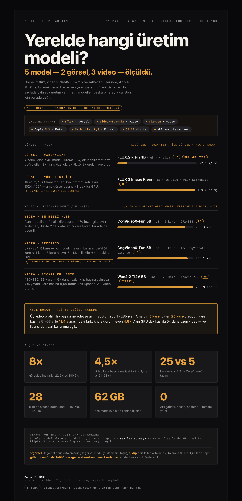

# local-generation-benchmark-m1-max

> Apple **M1 Max (64 GB)** üzerinde **yerel görsel ve video üretimi** — ölçülmüş,
> ve çıktılar depoya konmuş ki bakarak doğrulayabilesin.

[-000?logo=apple&logoColor=white)](#donanım--yazılım)
[](https://github.com/filipstrand/mflux)
[](https://github.com/dgrauet/VideoX-Fun-mlx)
[](evidence/)
[](LICENSE)

**Türkçe** · [English](README.md)

---

## Genel bakış

Yerel-MLX benchmark'ının **üretim yarısı**. Metin [oMLX](https://omlx.ai) üzerinde
çalışır ve
[companion deposunda](https://github.com/mahirfatih/omlx-m1-max-benchmark)
durur; burada oMLX'in çalıştıramadığı iki katman var:

| Katman | Araç | Model | Süre | Çıktı |
| :--- | :--- | :--- | ---: | :--- |
| **Görsel** | [mflux](https://github.com/filipstrand/mflux) | FLUX.2 klein 4B (q8) | **22.5 s** | 1024×1024 PNG |
| Görsel | mflux | Z-Image Turbo (q4) | 95.8 s | 1024×1024 PNG |
| Görsel | mflux | FLUX 3 Image Klein | 180.6 s | 1024×1024 PNG |
| **Video** | [VideoX-Fun-mlx](https://github.com/dgrauet/VideoX-Fun-mlx) | CogVideoX-Fun V1.5 5B (int8) | **266.1 s** | 672×384, 5 kare GIF |

Her sayı bu tek makinede **duvar saatiyle**, **model yüklemesi dahil** ölçüldü ve
her çıktı yazdığı dosyaya karşı doğrulandı — görsellerde PNG başlığı, kliplerde
`ffprobe` — aracın log satırına karşı değil. Görseller ve klipler
[`evidence/`](evidence/) altında, yani iddia güvenmekle değil **bakarak**
kontrol edilebilir.

**Ne yapacağına göre seç:**
[`docs/reference/COMPARISON.md`](docs/reference/COMPARISON.md) iki katmanı tek
sayfada verir; her rakam geldiği koşu dosyasına izlenir.

## İçindekiler

- [Donanım & Yazılım](#donanım--yazılım)
- [Ne ölçüldü](#ne-ölçüldü)
- [Görsel üretimi](#görsel-üretimi)
- [Video üretimi](#video-üretimi)
- [Profiller](#profiller)
- [Çoğaltma](#çoğaltma)
- [Depo yapısı](#depo-yapısı)
- [Notlar ve sorumluluk reddi](#notlar-ve-sorumluluk-reddi)
- [Lisans](#lisans)

## Donanım & Yazılım

| Öğe | Değer |
|---|---|
| Makine | **Apple MacBook Pro (16-inch, 2021)**, model `MacBookPro18,2` |
| Yonga | **Apple M1 Max** (10 çekirdek CPU: 8P + 2E, 32 çekirdek GPU, 16 çekirdek Neural Engine) |
| Bellek | **64 GB** birleşik |
| İşletim sistemi | **macOS 26.7.2** (build 25G332), arm64 |
| Görsel aracı | **mflux** — native-MLX difüzyon CLI'si, prompt başına bir süreç |
| Video aracı | **VideoX-Fun-mlx** (CogVideoX-Fun), **mlx-gen** (Wan2.2) |
| Ölçüm | Görsellerde PNG IHDR, kliplerde **`ffprobe`** |

Tam model önemli, o yüzden tarif edilmek yerine adıyla veriliyor — aşağıdaki
süreler 32 çekirdekli GPU'ya ve 400 GB/s bellek bant genişliğine karşıdır:

- Apple'ın kendi spesifikasyonu: [support.apple.com/en-us/111901](https://support.apple.com/en-us/111901)
- EveryMac'in bu tam konfigürasyonu:
  [MacBook Pro M1 Max 10-core CPU, 32-core GPU (16-inch, 2021)](https://everymac.com/systems/apple/macbook_pro/specs/macbook-pro-m1-max-10-core-cpu-32-core-gpu-16-2021-specs.html)

### Ortam

Donanım işin yarısı; diğer yarısı ağırlıkları neyin çalıştırdığı. Bu depoda
`llama.cpp`, `ollama` ya da GGUF çalıştıran tek bir satır yok — metin modelleri
[yardımcı deponun](https://github.com/mahirfatih/omlx-m1-max-benchmark) işi. Buradaki
iki katman da Apple'ın [MLX](https://github.com/ml-explore/mlx) çatısı üzerinde
koşan, modele özel Python inference motorlarıdır. MLX çalışma zamanıdır (PyTorch'un
karşılığı), motor değildir:

| Katman | Modeli ne çalıştırıyor | Neyin üstünde |
| :--- | :--- | :--- |
| Görsel | **mflux** — FLUX grafiği, sampler, VAE, tokenizer | MLX → Metal |
| Video (Wan) | **mlx-gen** — Wan2.2 grafiği ve sampler | MLX → Metal |
| Video (CogVideoX) | **VideoX-Fun-mlx** — CogVideoX-Fun grafiği ve sampler | MLX → Metal |
| Ölçüm | `scripts/measure/*.py` — motoru ayağa kaldırır, süreyi ölçer, dosyayı doğrular | Python 3 standart kütüphanesi |

Ölçümün yapıldığı sürümler:

| Öğe | Değer |
|---|---|
| Python | **3.15.2** (CPython, arm64, Homebrew) |
| Sanal ortam | `~/Sites/.mlxgen-venv` (1.4 GB, izole — Homebrew'un site-packages'i değil) |
| `mlx` | **0.32.4** |
| `mlx-metal` | **0.32.4** |
| `mlx-gen` | **0.38.0** (`mflux-generate*` komutlarını *ve* `mlxgen`'i getirir) |
| `mlx-arsenal` | **0.19.0** (VideoX-Fun-mlx ister, mlx-gen getirmez) |
| `ffmpeg` / `ffprobe` | **9.0.2** |

`pip install mflux` bilerek yok: mflux, `mlx-gen` paketinin içinden geliyor.
İkisini aynı ortama kurmak `mflux-generate*` betiklerinin sahibi konusunda
çakışır — bu yüzden `uv tool install` değil, ayrı bir sanal ortam.

```bash
python3.15 -m venv ~/Sites/.mlxgen-venv
~/Sites/.mlxgen-venv/bin/pip install mlx-gen mlx-arsenal
export PATH="$HOME/Sites/.mlxgen-venv/bin:$PATH"
```

Aynı anda tek GPU işi: başka bir `mflux`, `mlxgen` veya `quick_infer` süreci
yaşıyorsa harness başlamayı reddeder — ikisi 64 GB birleşik belleğe sığmaz.

**API yok, hesap yok, çağrı başına fatura yok.** Her model diskten yüklenir.

## Modeller

| Model | Disk | Quant | Lisans | Kaynak |
|---|---:|---|---|---|
| `flux2-klein-4b-mflux-q8` | 8.0 GB | int8 | Apache-2.0 | [HF](https://huggingface.co/mflux-community/flux2-klein-4b-mflux-q8) |
| `flux-3-image-klein-base-mflux-q8` | 9.2 GB | int8 | FLUX Kommunity | [HF](https://huggingface.co/mflux-community/flux-3-image-klein-base-mflux-q8) |
| `z-image-turbo-mflux-q4` | 5.5 GB | int4 | Apache-2.0 | [HF](https://huggingface.co/mflux-community/z-image-turbo-mflux-q4) |
| `CogVideoX-Fun-V1.5-5b-InP-mlx-q8` | 15 GB | int8 | CogVideoX License | [HF](https://huggingface.co/dgrauet/CogVideoX-Fun-V1.5-5b-InP-mlx-q8) |
| `CogVideoX-Fun-V1.5-5b-InP-mlx-q4` | 13 GB | int4 | CogVideoX License | [HF](https://huggingface.co/dgrauet/CogVideoX-Fun-V1.5-5b-InP-mlx-q4) |
| `wan2.2-ti2v-5b-diffusers-8bit` | 17 GB | int8 | Apache-2.0 | [HF](https://huggingface.co/AbstractFramework/wan2.2-ti2v-5b-diffusers-8bit) |

**Diskte toplam:** ~68 GB · **Çalışma belleği:** 64 GB birleşik bellekte model başına ~30 GB'a kadar. Her model diskteki ağırlıklardan çalışır — API yok, hesap yok.

## Model haritası



[`docs/diagrams/model-map/model-map.html`](docs/diagrams/model-map/model-map.html) — interaktif sürüm (tema değiştirilebilir). [`model-map-light.png`](docs/diagrams/model-map/model-map-light.png) açık tema için.

Hangi üretim modelinin hangi iş için, ve gerçekten ne kadara mal olduğunu, tek sayfada.

## Ne ölçüldü

| Paket | Kaynak | Neyi ölçer |
| :--- | :--- | :--- |
| Görsel | bizim, **mflux** üzerinden | Görsel başına saniye, PNG doğrulanır |
| Video | bizim, **VideoX-Fun-mlx** üzerinden | Klip başına saniye, `ffprobe` doğrulanır |
| Lisanslar | bizim, HF kartlarından | "İndirilebilir" mi, "ticari kullanılabilir" mi |

İki harness de modele dokunmadan önce kendini çevrimdışı doğrular:
`python3 scripts/measure/<paket>.py --selftest`. `test/test.sh` çevrimdışı kapıyı
çalıştırır ve harness'ların kendi fixture'larıyla anlaştığını kanıtlar.

## Görsel üretimi

Görsel, native-MLX bir difüzyon aracı olan
[mflux](https://github.com/filipstrand/mflux) üzerinden çalışır. Prompt başına bir
`mflux-generate-*` süreci, baştan sona zamanlanır, yazılan PNG doğrulanır.

| Model (profil) | Lisans | s/görsel | s/adım | Adım | Boyut |
| :--- | :--- | ---: | ---: | ---: | :--- |
| [`flux2-klein-4b-mflux-q8`](https://huggingface.co/mflux-community/flux2-klein-4b-mflux-q8) (`klein-q8`) | Apache-2.0 | **22.5** | 5.6 | 4 | 1024×1024 |
| [`z-image-turbo-mflux-q4`](https://huggingface.co/mflux-community/z-image-turbo-mflux-q4) (`z-image-turbo-q4`) | Apache-2.0 | 95.8 | 10.6 | 9 | 1024×1024 |
| [`flux-3-image-klein-base-mflux-q8`](https://huggingface.co/mflux-community/flux-3-image-klein-base-mflux-q8) (`flux3-klein-q8`) | FLUX Kommunity | 180.6 | 11.3 | 16 | 1024×1024 |

4 adımlı distile 4B model 1024×1024 görsel başına ~22.5 s koşar (ilki daha
yavaş, ~28 s, çünkü model yüklenir); FLUX 3 ise 16 adımda ve 5.6B transformer ile
~180 s. Z-Image Turbo — 9 adımlı distile 6B model, Apache-2.0 — ikisinin arasında
**95.8 s**'de durur: klein'den ~4.3×, FLUX 3'ten ~1.9× yavaş. Bütün sayılar ilk görsel
hariç, durağan 7 görselin ortalamasıdır — model yüklemesini taşıyan ilk görsel
dışarıda bırakılır; `s/görsel` kolonu budur.
**klein-q8 8× kazanır** ve özel olarak FLUX 3 gerekmiyorsa kullanılacak olandır.
Okunabilir metin ve doğru eller — klasik başarısızlık yüzeyleri — üçünde de
temiz çıktı. FLUX 3'ün ticari-çıktı sınırı devreye girdiğinde ama klein'in hızı
öncelik değilse, Apache-2.0 alternatifi Z-Image Turbo'dur.

Yirmi dört görsel, her biri kendisini üreten prompt ile:

[`evidence/image-benchmark-2026-11-12.md`](evidence/image-benchmark-2026-11-12.md),
[`evidence/image-benchmark-flux3-2026-11-12.md`](evidence/image-benchmark-flux3-2026-11-12.md)
ve [`evidence/image-benchmark-zimage-2026-11-14.md`](evidence/image-benchmark-zimage-2026-11-14.md).

## Video üretimi

Video, CogVideoX-Fun V1.5 5B (int8) süren
[VideoX-Fun-mlx](https://github.com/dgrauet/VideoX-Fun-mlx) üzerinden çalışır.
Prompt başına bir runner süreci, baştan sona zamanlanır ve her klip `ffprobe` ile
doğrulanır — runner'ın log satırıyla değil, dosyayla.

| Model (profil) | Lisans | s/klip | Çıktı | Kare | OK |
| :--- | :--- | ---: | :--- | ---: | :---: |
| [`dgrauet/CogVideoX-Fun-V1.5-5b-InP-mlx-q8`](https://huggingface.co/dgrauet/CogVideoX-Fun-V1.5-5b-InP-mlx-q8) (`cogvideox-fun-1.5-5b-inp-q8`) | **The CogVideoX License** | **266.1** | 672×384, 1.6 s, GIF | 5 | ✅ 4/4 |
| [`dgrauet/CogVideoX-Fun-V1.5-5b-InP-mlx-q4`](https://huggingface.co/dgrauet/CogVideoX-Fun-V1.5-5b-InP-mlx-q4) (`cogvideox-fun-1.5-5b-inp-q4`) | **The CogVideoX License** | **256.3** | 672×384, 1.6 s, GIF | 5 | ✅ 4/4 |
| [`AbstractFramework/wan2.2-ti2v-5b-diffusers-8bit`](https://huggingface.co/AbstractFramework/wan2.2-ti2v-5b-diffusers-8bit) (`wan22-ti2v-5b-q8`) | Apache-2.0 | **285.9** | 480×832, 1.6 s, MP4 | 25 | ✅ 4/4 |

5 karelik 672×384 bir klip için **266.1 s** — dört promptun ortalaması,
265.2–267.2 s aralığında — yani 1.6 s oynayan bir klip yaklaşık 4.4 dakika GPU
demek. Beş kare bu modelin **tavanı**, bir ayar değil: `--frames` doğrusal değil
(4 → 1 kare, 8 → 5 ile aynı, tek sayı reshape hatası verir), yani fazlasını
istemek fazlasını getirmiyor.

Dört klip, her biri kendisini üreten prompt ile:
[`evidence/video-benchmark-2026-11-12.md`](evidence/video-benchmark-2026-11-12.md).

## Profiller

Her katmanın kendi profil dosyası var — **hiçbir görsel veya video ayarı bir oMLX
profili değil**, çünkü oMLX ikisini de çalıştıramaz:

| Ayar | `klein-q8` | `flux3-klein-q8` | `cogvideox-fun-1.5-5b-inp-q8` |
| :--- | ---: | ---: | ---: |
| Katman | görsel | görsel | video |
| Boyut | 1024×1024 | 1024×1024 | 672×384 |
| Adım | 4 | 16 | 50 |
| Guidance | 1.0 | — (distile) | 6.0 |
| Seed | 42 | 42 | 42 |
| Çıktı | PNG | PNG | GIF, 5 kare |

Tam ayarlar, her değerin neden seçildiği ve bir koşuyu çoğaltmak için gereken
tam komutlar [`docs/reference/PROFILES.md`](docs/reference/PROFILES.md) içinde.

## Çoğaltma

1. Ortamı bir kez kur — Python 3.15, tek sanal ortam, iki kurulum:

   ```bash
   brew install python@3.15 ffmpeg
   python3.15 -m venv ~/Sites/.mlxgen-venv
   ~/Sites/.mlxgen-venv/bin/pip install mlx-gen mlx-arsenal
   export PATH="$HOME/Sites/.mlxgen-venv/bin:$PATH"
   git clone https://github.com/dgrauet/VideoX-Fun-mlx ~/Sites/VideoX-Fun-mlx
   ```

   Her parçanın neden gerektiği ve bilerek *kurulmayanlar*
   [`docs/reference/ENVIRONMENT.md`](docs/reference/ENVIRONMENT.md) içinde.
2. Model ağırlıklarını indir (tam model id'leri için
   [`docs/reference/PROFILES.md`](docs/reference/PROFILES.md)).
3. Harness'ı ya da tek-atış CLI'sini çalıştır — ikisi de
   [`docs/reference/PROFILES.md`](docs/reference/PROFILES.md#running-these-yourself)
   içinde.

```bash
# Görsel: sekiz promptluk paketin tamamı
python3 scripts/measure/image-benchmark.py --profile klein-q8 --out-dir ./out

# Video: dört promptluk paketin tamamı
python3 scripts/measure/video-benchmark.py \
  --profile cogvideox-fun-1.5-5b-inp-q8 \
  --repo ~/Sites/VideoX-Fun-mlx \
  --model ~/Sites/VideoX-Fun-mlx/models/cogvideox-fun-q8 \
  --out-dir /tmp/videorun --json-out /tmp/videorun/results.json
```

Çevrimdışı kapı model ve ağ istemez:

```bash
./test/test.sh
```

## Depo yapısı

```text
local-generation-benchmark-m1-max/
├── README.md · README.tr.md
├── CHANGELOG.md · CONTRIBUTING.md · CODE_OF_CONDUCT.md · SECURITY.md
├── data/                       # prompt setleri, katman başına bir JSON
│   ├── image-prompts.json
│   └── video-prompts.json
├── profiles/
│   ├── mflux-profiles.json     # görsel ayarları
│   └── video-profiles.json     # video ayarları
├── evidence/                   # koşular: sayfalar ve görseller/klipler
│   ├── image-benchmark-*.md
│   ├── video-benchmark-*.md
│   ├── images/                 # 24 PNG
│   └── videos/                 # 4 GIF
├── reference/                  # her sayının makine-okunur kopyası
├── docs/
│   ├── README.md
│   ├── diagrams/               # model-map poster'u: HTML özgün + PNG çıktıları
│   ├── guides/                 # adlandırma kuralları
│   └── reference/              # karşılaştırma · profiller · lisanslar · ortam
├── scripts/
│   ├── measure/                # image-benchmark.py, video-benchmark.py
│   ├── release/                # export-video-evidence.py
│   ├── render/                 # render-model-map.py — poster HTML → PNG
│   └── lint.sh
└── test/test.sh                # çevrimdışı kapı
```

## Notlar ve sorumluluk reddi

- **Süreler yalnızca bu makine için.** Farklı bir M1/M2/M3/M4 bunları değiştirir.
- **Örneklem küçük.** Sekiz görsel promptu, dört video promptu. Bir iki saniyelik
  fark gürültüdür; 8× fark değildir.
- **Hız ve kalite tek bir puan değil.** [`evidence/images/`](evidence/images/) ve
  [`evidence/videos/`](evidence/videos/) klasörlerine bak ve çıktıyı kendin yargıla.
- **İndirmek lisans değildir.** FLUX 3 ve CogVideoX, Apache-2.0'ın vermediği
  koşullar taşır; para kazanan bir şeye katmadan önce
  [`docs/reference/LICENSES.md`](docs/reference/LICENSES.md) oku.
- Bu depo **hiçbir model ağırlığını yeniden dağıtmaz** — yalnızca ölçümleri ve o
  modellerin ürettiği çıktıları.

## Lisans

Buradaki kod ve belgeler **MIT**'tir (bkz. [`LICENSE`](LICENSE)). Bu, bu depoyu
kapsar, ölçtüğü modelleri değil: model lisansları yazarlarının malıdır ve
ağırlıklarla birlikte gider.
