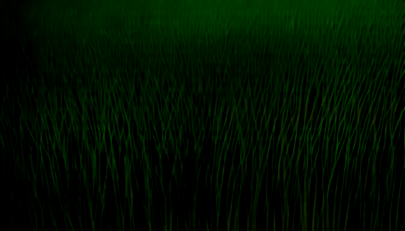
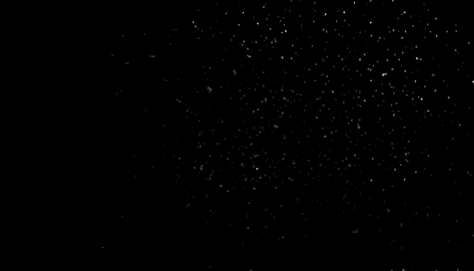
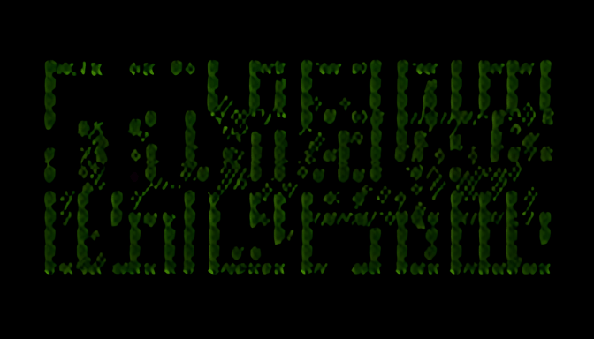
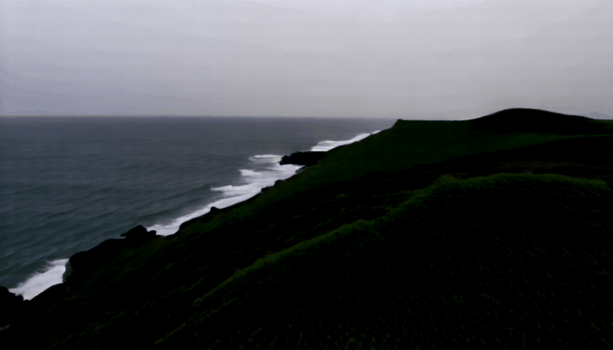
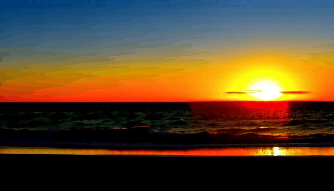
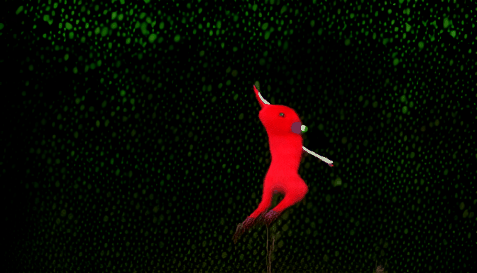
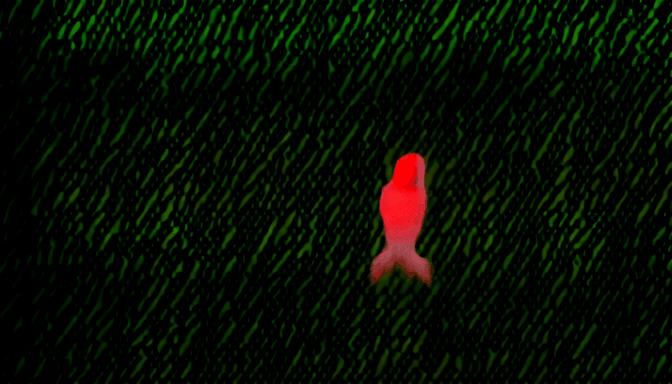

# Video generation — seconds per clip

**Date:** 2026-11-20. One runner process per prompt, through an MLX video tool ([`mlx-gen`](https://github.com/lpalbou/mlx-gen) for Wan2.2, [`VideoX-Fun-mlx`](https://github.com/dgrauet/VideoX-Fun-mlx) for the CogVideoX-Fun layer), which is separate from the oMLX text server and from the mflux image layer. Time is end-to-end wall clock, **model load included**; the runner is one-shot. Each output is probed with `ffprobe`, so the size and length are read from the file, not from the runner's log.

Six prompts per profile — the four original ones plus `scene-sunset-ocean` and `motion-snowy-fox`.

## CogVideoX-Fun V1.5 5B (int8) — The CogVideoX License

| Model (profile) | Licence | Prompt | s/clip | Output | Frames | fps | Codec | OK |
|---|---|---|---|---:|---|---:|---:|---|:---:|
| `dgrauet/CogVideoX-Fun-V1.5-5b-InP-mlx-q8` (cogvideox-fun-1.5-5b-inp-q8) | The CogVideoX License (the quant is tagged apache-2.0) | `motion-horse-gallop` | 274.90 | 672×384, 1.6s, 0.7 MB | 5 | 3.125 | gif | ✅ |
| `dgrauet/CogVideoX-Fun-V1.5-5b-InP-mlx-q8` (cogvideox-fun-1.5-5b-inp-q8) | The CogVideoX License (the quant is tagged apache-2.0) | `camera-orbit-tower` | 259.18 | 672×384, 1.6s, 0.1 MB | 5 | 3.125 | gif | ✅ |
| `dgrauet/CogVideoX-Fun-V1.5-5b-InP-mlx-q8` (cogvideox-fun-1.5-5b-inp-q8) | The CogVideoX License (the quant is tagged apache-2.0) | `physics-tea-pour` | 260.12 | 672×384, 1.6s, 0.3 MB | 5 | 3.125 | gif | ✅ |
| `dgrauet/CogVideoX-Fun-V1.5-5b-InP-mlx-q8` (cogvideox-fun-1.5-5b-inp-q8) | The CogVideoX License (the quant is tagged apache-2.0) | `scene-storm-coast` | 259.87 | 672×384, 1.6s, 0.3 MB | 5 | 3.125 | gif | ✅ |
| `dgrauet/CogVideoX-Fun-V1.5-5b-InP-mlx-q8` (cogvideox-fun-1.5-5b-inp-q8) | The CogVideoX License (the quant is tagged apache-2.0) | `scene-sunset-ocean` | 258.67 | 672×384, 1.6s, 0.2 MB | 5 | 3.125 | gif | ✅ |
| `dgrauet/CogVideoX-Fun-V1.5-5b-InP-mlx-q8` (cogvideox-fun-1.5-5b-inp-q8) | The CogVideoX License (the quant is tagged apache-2.0) | `motion-snowy-fox` | 259.91 | 672×384, 1.6s, 0.6 MB | 5 | 3.125 | gif | ✅ |

_q8 mean: 262.1 s/clip (six prompts, 258.7–274.9 s)._

## CogVideoX-Fun V1.5 5B (int4) — quantisation comparison

Same runner, same six prompts, same settings, one quantisation step down. The only change is the weight file (q4 vs q8).

| Model (profile) | Licence | Prompt | s/clip | Output | Frames | fps | Codec | OK |
|---|---|---|---|---:|---|---:|---:|---|:---:|
| `dgrauet/CogVideoX-Fun-V1.5-5b-InP-mlx-q4` (cogvideox-fun-1.5-5b-inp-q4) | The CogVideoX License (the quant is tagged apache-2.0) | `motion-horse-gallop` | 253.43 | 672×384, 1.6s, 0.9 MB | 5 | 3.125 | gif | ✅ |
| `dgrauet/CogVideoX-Fun-V1.5-5b-InP-mlx-q4` (cogvideox-fun-1.5-5b-inp-q4) | The CogVideoX License (the quant is tagged apache-2.0) | `camera-orbit-tower` | 247.44 | 672×384, 1.6s, 0.1 MB | 5 | 3.125 | gif | ✅ |
| `dgrauet/CogVideoX-Fun-V1.5-5b-InP-mlx-q4` (cogvideox-fun-1.5-5b-inp-q4) | The CogVideoX License (the quant is tagged apache-2.0) | `physics-tea-pour` | 246.61 | 672×384, 1.6s, 0.4 MB | 5 | 3.125 | gif | ✅ |
| `dgrauet/CogVideoX-Fun-V1.5-5b-InP-mlx-q4` (cogvideox-fun-1.5-5b-inp-q4) | The CogVideoX License (the quant is tagged apache-2.0) | `scene-storm-coast` | 245.62 | 672×384, 1.6s, 0.3 MB | 5 | 3.125 | gif | ✅ |
| `dgrauet/CogVideoX-Fun-V1.5-5b-InP-mlx-q4` (cogvideox-fun-1.5-5b-inp-q4) | The CogVideoX License (the quant is tagged apache-2.0) | `scene-sunset-ocean` | 247.76 | 672×384, 1.6s, 0.2 MB | 5 | 3.125 | gif | ✅ |
| `dgrauet/CogVideoX-Fun-V1.5-5b-InP-mlx-q4` (cogvideox-fun-1.5-5b-inp-q4) | The CogVideoX License (the quant is tagged apache-2.0) | `motion-snowy-fox` | 245.17 | 672×384, 1.6s, 0.6 MB | 5 | 3.125 | gif | ✅ |

_q4 mean: 247.7 s/clip vs q8's 262.1 s/clip — about 5.5% faster, same frame count and resolution._

The time is shorter and the **quality is not guaranteed on either quant**. On the
`motion-snowy-fox` prompt at seed 42 both the q4 and the q8 resolve to green
dither with a red shape (the q4 clip is in the q4 section below); a sunset prompt
at seed 42 gave a clean sunset on the q8, and a q4 sunset at seed 7 was coherent —
the same quant that dithers on the fox. The failure tracks the prompt/seed pair,
not the weight file. So treat a fast q4 row as a compute measurement and check the
file before trusting the picture.

## The clips themselves

These are the models' normal output at the profiles' settings, not a selected
best-of. Each CogVideoX clip is an animated GIF of five frames, so it **plays in
the browser but stops abruptly** — that is the model's clip length, not an export
error. The Wan clip is a 25-frame MP4. The prompt is quoted under each clip.

### `motion-horse-gallop` — motion

> A single brown horse galloping left to right across a flat green field, legs moving in a correct gait, dust kicked up behind the hooves, camera tracking alongside at a constant distance, overcast afternoon light.

### `camera-orbit-tower` — camera

> A slow smooth camera orbit around a small stone lighthouse on a rocky headland, the sea behind it, the light in the tower rotating once, late golden hour, the horizon staying level throughout.

### `physics-tea-pour` — physics

> Close-up of dark tea being poured from a ceramic pot into a small glass cup, a steady stream that narrows as the cup fills, gentle steam rising, the surface rippling, a warm kitchen background slightly out of focus.

### `scene-storm-coast` — scene

> A wide fixed shot of a stormy coastline, large waves breaking against black rocks, sea spray thrown into the air, low grey clouds moving quickly inland, grass on the clifftop bending in the wind, no people.

### `scene-sunset-ocean` — scene

> A beautiful sunset over the ocean, waves rolling gently toward the shore, the sun low and orange on the horizon, warm light reflecting on the water, a calm wide establishing shot.

### `motion-snowy-fox` — motion

> A red fox running through a snowy pine forest, soft falling snow, camera tracking sideways alongside the animal as it moves across the frame.

18 of 18 clips rendered. The `--frames` flag is not linear: the pipeline decodes
`(F-1)//4*4+1` frames, so asking for 4 decodes to 1 frame and asking for 6 or 8
decodes to the same 5 as asking for 5, while 9, 17 and 25 raise a reshape error —
`F` must be `1 mod 4`. Five frames is the cheapest usable value, not a ceiling:
`--frames 13` decodes to 13. The runner's log line disagrees with the file, which
is why the frame column above is `ffprobe`'s.

## Wan2.2 TI2V 5B (int8) — Apache-2.0, local MLX

Run through `mlxgen generate` against the local folder `~/models/AbstractFramework/wan2.2-ti2v-5b-diffusers-8bit` (17 GB, oMLX-style quantisation). Settings: 480×832, 25 frames at 16 fps, 20 steps, guidance 5, seed 42, `--low-ram`. Licence Apache-2.0, inherited from the base model.

| Model (profile) | Licence | Prompt | s/clip | Output | Frames | fps | Codec | OK |
|---|---|---|---|---:|---|---:|---:|---|:---:|
| `AbstractFramework/wan2.2-ti2v-5b-diffusers-8bit` (wan22-ti2v-5b-q8) | Apache-2.0 | `motion-horse-gallop` | 234.80 | 480×832, 1.6s, 0.2 MB | 25 | 16.0 | h264 | ✅ |
| `AbstractFramework/wan2.2-ti2v-5b-diffusers-8bit` (wan22-ti2v-5b-q8) | Apache-2.0 | `camera-orbit-tower` | 233.65 | 480×832, 1.6s, 0.2 MB | 25 | 16.0 | h264 | ✅ |
| `AbstractFramework/wan2.2-ti2v-5b-diffusers-8bit` (wan22-ti2v-5b-q8) | Apache-2.0 | `physics-tea-pour` | 233.99 | 480×832, 1.6s, 0.2 MB | 25 | 16.0 | h264 | ✅ |
| `AbstractFramework/wan2.2-ti2v-5b-diffusers-8bit` (wan22-ti2v-5b-q8) | Apache-2.0 | `scene-storm-coast` | 233.71 | 480×832, 1.6s, 0.3 MB | 25 | 16.0 | h264 | ✅ |
| `AbstractFramework/wan2.2-ti2v-5b-diffusers-8bit` (wan22-ti2v-5b-q8) | Apache-2.0 | `scene-sunset-ocean` | 299.83 | 480×832, 1.6s, 0.2 MB | 25 | 16.0 | h264 | ✅ |
| `AbstractFramework/wan2.2-ti2v-5b-diffusers-8bit` (wan22-ti2v-5b-q8) | Apache-2.0 | `motion-snowy-fox` | 297.88 | 480×832, 1.6s, 0.9 MB | 25 | 16.0 | h264 | ✅ |

_Wan mean: 255.6 s/clip (233.7–299.8 s), 25 frames at 16 fps._

The **spread is wider than the other two profiles** (233.7–299.8 s): the two
prompts added on 2026-11-20 (`scene-sunset-ocean`, `motion-snowy-fox`) cost ~64 s
more than the four original prompts (~234 s each). Wan's sampler evidently scales
with something in the prompt's token count or conditioning, so its `s/clip` is
more prompt-dependent than CogVideoX's, whose six clips span under 17 s. Read the
mean with that in mind, and the range beside it.

## The clips themselves (Wan2.2)

### `motion-horse-gallop` — motion

> A single brown horse galloping left to right across a flat green field, legs moving in a correct gait, dust kicked up behind the hooves, camera tracking alongside at a constant distance, overcast afternoon light.

### `camera-orbit-tower` — camera

> A slow smooth camera orbit around a small stone lighthouse on a rocky headland, the sea behind it, the light in the tower rotating once, late golden hour, the horizon staying level throughout.

### `physics-tea-pour` — physics

> Close-up of dark tea being poured from a ceramic pot into a small glass cup, a steady stream that narrows as the cup fills, gentle steam rising, the surface rippling, a warm kitchen background slightly out of focus.

### `scene-storm-coast` — scene

> A wide fixed shot of a stormy coastline, large waves breaking against black rocks, sea spray thrown into the air, low grey clouds moving quickly inland, grass on the clifftop bending in the wind, no people.

### `scene-sunset-ocean` — scene

> A beautiful sunset over the ocean, waves rolling gently toward the shore, the sun low and orange on the horizon, warm light reflecting on the water, a calm wide establishing shot.

### `motion-snowy-fox` — motion

> A red fox running through a snowy pine forest, soft falling snow, camera tracking sideways alongside the animal as it moves across the frame.

