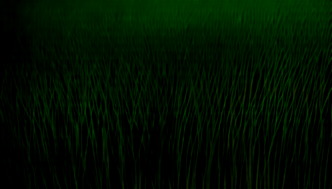
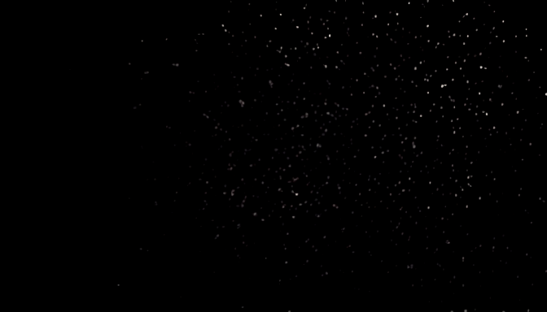
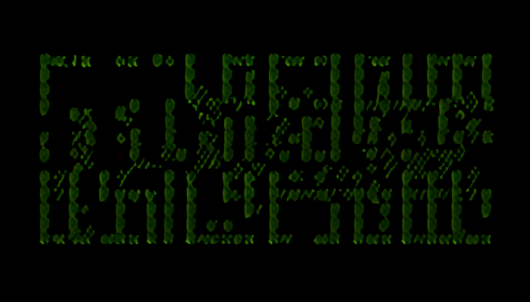
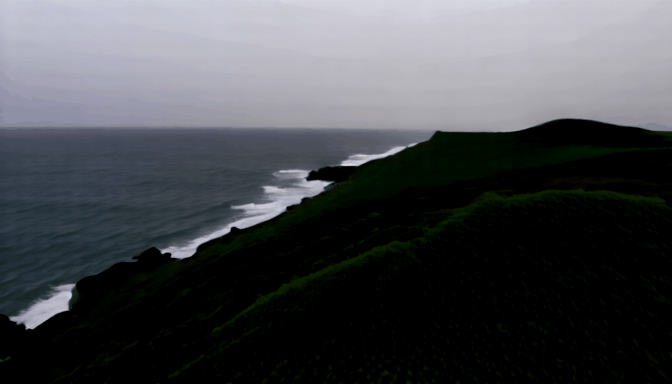
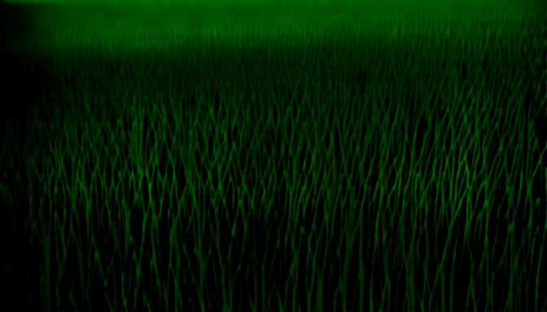
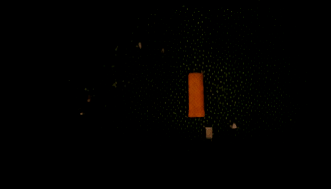
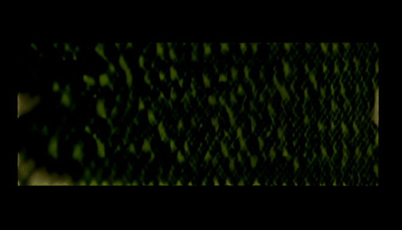
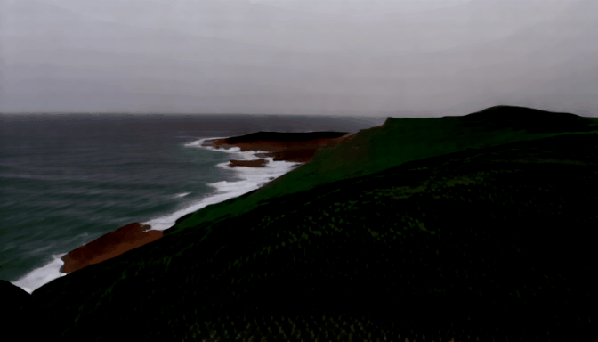

# Video generation — seconds per clip

**Date:** 2026-11-12. One runner process per prompt, through an MLX video tool ([`VideoX-Fun-mlx`](https://github.com/dgrauet/VideoX-Fun-mlx) for the CogVideoX-Fun layer), which is separate from the oMLX text server and from the mflux image layer. Time is end-to-end wall clock, **model load included**; the runner is one-shot. Each output is probed with `ffprobe`, so the size and length are read from the file, not from the runner's log.

| Model (profile) | Licence | Prompt | s/clip | Output | Frames | fps | Codec | OK |
|---|---|---|---:|---|---:|---:|---|:---:|
| `dgrauet/CogVideoX-Fun-V1.5-5b-InP-mlx-q8` (cogvideox-fun-1.5-5b-inp-q8) | The CogVideoX License (the quant is tagged apache-2.0) | `motion-horse-gallop` | 265.17 | 672×384, 1.6s, 0.8 MB | 5 | 3.125 | gif | ✅ |
| `dgrauet/CogVideoX-Fun-V1.5-5b-InP-mlx-q8` (cogvideox-fun-1.5-5b-inp-q8) | The CogVideoX License (the quant is tagged apache-2.0) | `camera-orbit-tower` | 267.19 | 672×384, 1.6s, 0.1 MB | 5 | 3.125 | gif | ✅ |
| `dgrauet/CogVideoX-Fun-V1.5-5b-InP-mlx-q8` (cogvideox-fun-1.5-5b-inp-q8) | The CogVideoX License (the quant is tagged apache-2.0) | `physics-tea-pour` | 266.27 | 672×384, 1.6s, 0.3 MB | 5 | 3.125 | gif | ✅ |
| `dgrauet/CogVideoX-Fun-V1.5-5b-InP-mlx-q8` (cogvideox-fun-1.5-5b-inp-q8) | The CogVideoX License (the quant is tagged apache-2.0) | `scene-storm-coast` | 265.96 | 672×384, 1.6s, 0.4 MB | 5 | 3.125 | gif | ✅ |

_s/clip is what a person waits for one finished clip on this machine, model load included. The size, length and frame count come from `ffprobe` on the written file, not from the runner's own log line._

## The clips themselves

These are the model's normal output at the profile's settings, not a selected best-of. Each is written as an animated GIF of a handful of frames, so **it plays in the browser but stops abruptly** — that is the model's clip length, not an export error. The prompt is quoted under each clip so you can judge the result against what was actually asked.

### `motion-horse-gallop` — motion

> A single brown horse galloping left to right across a flat green field, legs moving in a correct gait, dust kicked up behind the hooves, camera tracking alongside at a constant distance, overcast afternoon light.

### `camera-orbit-tower` — camera

> A slow smooth camera orbit around a small stone lighthouse on a rocky headland, the sea behind it, the light in the tower rotating once, late golden hour, the horizon staying level throughout.

### `physics-tea-pour` — physics

> Close-up of dark tea being poured from a ceramic pot into a small glass cup, a steady stream that narrows as the cup fills, gentle steam rising, the surface rippling, a warm kitchen background slightly out of focus.

### `scene-storm-coast` — scene

> A wide fixed shot of a stormy coastline, large waves breaking against black rocks, sea spray thrown into the air, low grey clouds moving quickly inland, grass on the clifftop bending in the wind, no people.

4 of 4 clips rendered. The `--frames` flag is not linear and this model tops out at 5 frames: asking for 4 decodes to 1 frame, asking for 8 decodes to the same 5 as asking for 5, and an odd count raises a reshape error because the patch size is 2. The runner's log line disagrees with the file, which is why the frame column above is `ffprobe`'s.

---

## q4 (int4) — quantisation comparison

Same runner, same four prompts, same settings, one quantisation step down. The only change is the weight file (q4 vs q8); the profile, the prompt set and the harness are identical.

| Model (profile) | Licence | Prompt | s/clip | Output | Frames | fps | Codec | OK |
|---|---|---|---:|---|---:|---:|---|:---:|
| `dgrauet/CogVideoX-Fun-V1.5-5b-InP-mlx-q4` (cogvideox-fun-1.5-5b-inp-q4) | The CogVideoX License (the quant is tagged apache-2.0) | `motion-horse-gallop` | 254.90 | 672×384, 1.6s, 0.9 MB | 5 | 3.125 | gif | ✅ |
| `dgrauet/CogVideoX-Fun-V1.5-5b-InP-mlx-q4` (cogvideox-fun-1.5-5b-inp-q4) | The CogVideoX License (the quant is tagged apache-2.0) | `camera-orbit-tower` | 256.50 | 672×384, 1.6s, 0.1 MB | 5 | 3.125 | gif | ✅ |
| `dgrauet/CogVideoX-Fun-V1.5-5b-InP-mlx-q4` (cogvideox-fun-1.5-5b-inp-q4) | The CogVideoX License (the quant is tagged apache-2.0) | `physics-tea-pour` | 256.15 | 672×384, 1.6s, 0.4 MB | 5 | 3.125 | gif | ✅ |
| `dgrauet/CogVideoX-Fun-V1.5-5b-InP-mlx-q4` (cogvideox-fun-1.5-5b-inp-q4) | The CogVideoX License (the quant is tagged apache-2.0) | `scene-storm-coast` | 257.79 | 672×384, 1.6s, 0.4 MB | 5 | 3.125 | gif | ✅ |

_q4 mean: 256.3 s/clip vs q8's 266.1 s/clip — about 4% faster, same frame count and resolution._

## The clips themselves (q4)

Same prompts as above, one quantisation step down.

### `motion-horse-gallop` — motion

> A single brown horse galloping left to right across a flat green field, legs moving in a correct gait, dust kicked up behind the hooves, camera tracking alongside at a constant distance, overcast afternoon light.

### `camera-orbit-tower` — camera

> A slow smooth camera orbit around a small stone lighthouse on a rocky headland, the sea behind it, the light in the tower rotating once, late golden hour, the horizon staying level throughout.

### `physics-tea-pour` — physics

> Close-up of dark tea being poured from a ceramic pot into a small glass cup, a steady stream that narrows as the cup fills, gentle steam rising, the surface rippling, a warm kitchen background slightly out of focus.

### `scene-storm-coast` — scene

> A wide fixed shot of a stormy coastline, large waves breaking against black rocks, sea spray thrown into the air, low grey clouds moving quickly inland, grass on the clifftop bending in the wind, no people.

---

## Wan2.2 TI2V 5B (int8) — Apache-2.0, local MLX

Run through `mlxgen generate --family wan` against the local folder `~/models/AbstractFramework/wan2.2-ti2v-5b-diffusers-8bit` (17 GB, oMLX-style quantisation). Settings: 480×832, 25 frames at 16 fps, 20 steps, guidance 5, seed 42, `--low-ram`. Licence Apache-2.0, inherited from the base model.

| Model (profile) | Licence | Prompt | s/clip | Output | Frames | fps | Codec | OK |
|---|---|---|---:|---|---:|---:|---|:---:|
| `AbstractFramework/wan2.2-ti2v-5b-diffusers-8bit` (wan22-ti2v-5b-q8) | Apache-2.0 | `motion-horse-gallop` | 237.00 | 480×832, 1.6s, 0.3 MB | 25 | 16.0 | mp4 | ✅ |
| `AbstractFramework/wan2.2-ti2v-5b-diffusers-8bit` (wan22-ti2v-5b-q8) | Apache-2.0 | `camera-orbit-tower` | 299.44 | 480×832, 1.6s, 0.2 MB | 25 | 16.0 | mp4 | ✅ |
| `AbstractFramework/wan2.2-ti2v-5b-diffusers-8bit` (wan22-ti2v-5b-q8) | Apache-2.0 | `physics-tea-pour` | 305.30 | 480×832, 1.6s, 0.2 MB | 25 | 16.0 | mp4 | ✅ |
| `AbstractFramework/wan2.2-ti2v-5b-diffusers-8bit` (wan22-ti2v-5b-q8) | Apache-2.0 | `scene-storm-coast` | 301.93 | 480×832, 1.6s, 0.4 MB | 25 | 16.0 | mp4 | ✅ |

_Wan mean: 285.9 s/clip (237.0–305.3 s range), 25 frames at 16 fps._

## The clips themselves (Wan2.2)

### `motion-horse-gallop` — motion

> A single brown horse galloping left to right across a flat green field, legs moving in a correct gait, dust kicked up behind the hooves, camera tracking alongside at a constant distance, overcast afternoon light.

### `camera-orbit-tower` — camera

> A slow smooth camera orbit around a small stone lighthouse on a rocky headland, the sea behind it, the light in the tower rotating once, late golden hour, the horizon staying level throughout.

### `physics-tea-pour` — physics

> Close-up of dark tea being poured from a ceramic pot into a small glass cup, a steady stream that narrows as the cup fills, gentle steam rising, the surface rippling, a warm kitchen background slightly out of focus.

### `scene-storm-coast` — scene

> A wide fixed shot of a stormy coastline, large waves breaking against black rocks, sea spray thrown into the air, low grey clouds moving quickly inland, grass on the clifftop bending in the wind, no people.

